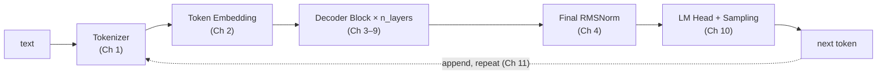
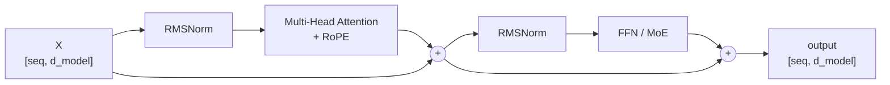
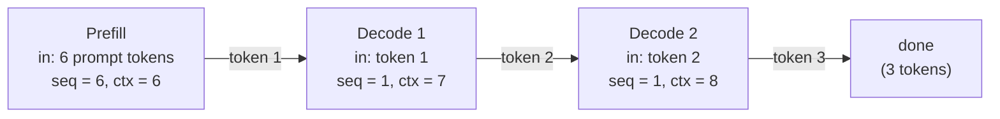

# Chapter 0 — Overview: Transformer-Based LLM Architecture

This tutorial follows one prompt through a decoder-only Transformer LLM during
**inference**, from raw text in to the next token out. Each chapter covers one component.

## The inference pipeline at a glance

Inside each decoder block:

## Chapters

| Ch | Topic | What it covers |
|----|-------|----------------|
| 0  | Overview | This page: the pipeline and the chapter map |
| 1  | [Tokenizer](ch-1-tokenizer.md) | Text → token IDs; BPE, vocabulary, special tokens |
| 2  | [Token Embedding](ch-2-token-embedding.md) | Token IDs → vectors; the embedding table `[vocab, d_model]` |
| 3  | [Positional Encoding](ch-3-positional-encoding.md) | Why order must be injected; absolute/sinusoidal vs. RoPE |
| 4  | [Normalization](ch-4-normalization.md) | LayerNorm vs. RMSNorm; pre-norm vs. post-norm |
| 5  | [Self-Attention](ch-5-self-attention.md) | Q, K, V; scaled dot-product; causal mask |
| 6  | [Multi-Head Attention](ch-6-multi-head-attention.md) | Splitting into heads; output projection; MQA and GQA |
| 7  | [Feed-Forward Network](ch-7-feed-forward-network.md) | Classic FFN and SwiGLU; cost per token  |
| 8  | [Residuals & the Decoder Block](ch-8-decoder-block.md) | How the pieces stack into one block and `n_layers` blocks |
| 9  | [Mixture of Experts (MoE)](ch-9-mixture-of-experts.md) | Router, top-k experts, total vs. active parameters |
| 10 | [LM Head & Sampling](ch-10-lm-head-and-sampling.md) | Logits over the vocabulary; softmax; greedy, temperature, top-k, top-p |
| 11 | [The Inference Loop](ch-11-inference-loop.md) | Prefill vs. decode; KV cache; why decode is memory-bound |
| 12 | [Putting It Together](ch-12-putting-it-together.md) | One full forward pass with Llama-2-7B-sized numbers |

## Notation

All chapters use the symbols below. Unless a chapter says otherwise, values are those of a
Llama-2-7B-like configuration (the **running example**).

| Symbol | Meaning | Running-example value |
|--------|---------|-----------------------|
| `seq` | Number of tokens in the **current forward pass** = number of rows of `X`. Prefill: the prompt length. Decode: 1 (only the newest token). | `6` (the prompt in Ch 12) |
| `ctx` | Number of tokens processed **so far** (prompt + generated) = length of the KV cache = how many positions attention can look at. In prefill, `ctx = seq`. | grows by 1 per decode step |
| `max_seq` | Context window: the largest `ctx` the model supports. | 4,096 |
| `vocab` | Vocabulary size (number of distinct token IDs). | 32,000 |
| `d_model` | Width of each token's hidden vector (the residual stream). | 4,096 |
| `n_layers` | Number of decoder blocks. | 32 |
| `n_heads` | Number of attention (query) heads. | 32 |
| `n_kv_heads` | Number of key/value heads (`= n_heads` for MHA, fewer for GQA/MQA, Ch 6). | 32 |
| `d_h` | Head dimension `= d_model / n_heads`. | 128 |
| `d_ff` | Hidden width of the FFN (Ch 7). | 11,008 (SwiGLU) |
| `n_experts`, `k` | MoE only: experts per layer, experts used per token (Ch 9). | — (dense model) |
| `batch` | Number of sequences processed together. | 1 |

Tensor names:

- `X : [seq, d_model]` — the hidden states of all tokens in the pass, one row per token.
- `x : [d_model]` — one row of `X`, i.e. one token's hidden vector.
- `h : [seq, d_model]` — the residual stream after the attention sub-layer of a block (Ch 8).
- `Y : [seq, d_model]` — the output of a block or sub-layer; lowercase `y : [d_model]` is one row of it.
- Shapes are written `[rows, columns]`; a weight `W : [a, b]` maps width `a` to width `b`.

### `seq` vs. `ctx` during generation

**How the inference loop works (details in Ch 11):** every forward pass outputs exactly **one**
new token. **Prefill** is the first pass: it feeds in the whole prompt and already outputs
generated token 1. Each **decode** step then feeds in only the token produced by the previous
pass and outputs the next one. So generating `n` tokens takes 1 prefill + `n − 1` decode steps.

For a 6-token prompt generating 3 tokens:

| Step | Tokens fed in | `seq` | `ctx` (KV cache length after the step) | Token produced |
|------|---------------|------:|------:|----------------|
| Prefill | the 6 prompt tokens | 6 | 6 | generated token 1 |
| Decode 1 | generated token 1 | 1 | 7 | generated token 2 |
| Decode 2 | generated token 2 | 1 | 8 | generated token 3 |

Every per-token layer (embedding, norms, projections, FFN, LM head) sees `seq` rows. Only
attention also reaches back over all `ctx` positions through the KV cache (Ch 5, Ch 11).

## References

The most important sources for this chapter, in order of importance.

1. Vaswani, A., Shazeer, N., Parmar, N., et al. (2017). *Attention Is All You Need*. NeurIPS 2017. [arXiv:1706.03762](https://arxiv.org/abs/1706.03762) — the Transformer architecture.
2. Brown, T., Mann, B., Ryder, N., et al. (2020). *Language Models are Few-Shot Learners*. NeurIPS 2020. [arXiv:2005.14165](https://arxiv.org/abs/2005.14165) — decoder-only LLMs at scale.
3. Chowdhery, A., Narang, S., Devlin, J., et al. (2023). *PaLM: Scaling Language Modeling with Pathways*. JMLR 24. [arXiv:2204.02311](https://arxiv.org/abs/2204.02311) — a modern decoder-only LLM: SwiGLU, RoPE, MQA.
4. Bengio, Y., Ducharme, R., Vincent, P., Jauvin, C. (2003). *A Neural Probabilistic Language Model*. Journal of Machine Learning Research, 3, 1137–1155. — neural language models predicting the next token.
5. Pope, R., Douglas, S., Chowdhery, A., et al. (2023). *Efficiently Scaling Transformer Inference*. MLSys 2023. [arXiv:2211.05102](https://arxiv.org/abs/2211.05102) — prefill/decode and inference cost analysis.
6. Hoffmann, J., Borgeaud, S., Mensch, A., et al. (2022). *Training Compute-Optimal Large Language Models*. NeurIPS 2022. [arXiv:2203.15556](https://arxiv.org/abs/2203.15556) — model size vs. compute trade-offs.
7. Jurafsky, D., Martin, J. H. *Speech and Language Processing* (3rd ed. draft). Online textbook, https://web.stanford.edu/~jurafsky/slp3/ — textbook: transformers and LLMs.
8. Raschka, S. (2024). *Build a Large Language Model (From Scratch)*. Manning. — textbook: building a GPT-style LLM step by step.
9. Goodfellow, I., Bengio, Y., Courville, A. (2016). *Deep Learning*. MIT Press. https://www.deeplearningbook.org/ — textbook: deep-learning foundations.
10. Zhang, A., Lipton, Z. C., Li, M., Smola, A. J. (2023). *Dive into Deep Learning*. Cambridge University Press. https://d2l.ai/ — textbook: attention and Transformers with code.
