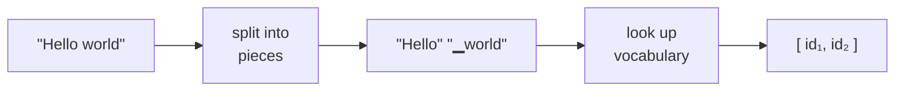
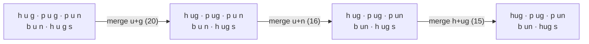

# Chapter 1 — Tokenizer

A neural network cannot read text. The tokenizer turns a string into a list of integer
**token IDs**, and turns IDs back into text after generation. It is not a neural network:
it is a fixed lookup procedure learned once, before model training.



## 1. Why sub-words?

| Unit       | Vocabulary size | Problem |
|------------|-----------------|---------|
| Characters | ~100s           | Sequences become very long; each token carries little meaning |
| Words      | millions        | Huge vocabulary; unseen words cannot be represented |
| **Sub-words** | 30k – 200k   | Common words are one token, rare words split into pieces |

Sub-word tokenizers give a balance: frequent words like `the` are a single token, while a
rare word like `tokenization` might become `token` + `ization`. As a rough rule of thumb,
English text averages about 4 characters (≈ ¾ of a word) per token.

## 2. Byte-Pair Encoding (BPE)

Most LLM tokenizers use BPE or a close variant.

**Training** (done once, on a large corpus):

1. Start with a vocabulary of single characters (or bytes).
2. Count every adjacent pair of symbols in the corpus.
3. Merge the most frequent pair into a new symbol; record the merge.
4. Repeat until the vocabulary reaches the target size.

**Encoding** new text: split into characters, then apply the recorded merges in the same order.

### Worked example

Corpus word counts: `hug`×10, `pug`×5, `pun`×12, `bun`×4, `hugs`×5.



| Step | Pair counts (top ones)                              | Merge      |
|------|-----------------------------------------------------|------------|
| 1    | `u g`=10+5+5=**20**, `p u`=17, `u n`=16, `h u`=15   | `u g → ug` |
| 2    | `u n`=12+4=**16**, `h ug`=15, `p u`=12              | `u n → un` |
| 3    | `h ug`=10+5=**15**, `p un`=12                       | `h ug → hug` |

Encoding the unseen word `bugs` with merges `[ug, un, hug]`:
`b u g s` → `b ug s` → no more merges apply → tokens **`[b, ug, s]`**.

No word is ever "unknown": in the worst case it falls back to single characters.
**Byte-level** BPE (GPT-2 and later) starts from the 256 byte values instead of characters, so
any UTF-8 text — emoji, code, any language — can be encoded.

## 3. Vocabulary and special tokens

| Model       | Tokenizer                    | Vocabulary |
|-------------|------------------------------|-----------:|
| GPT-2       | byte-level BPE               | 50,257     |
| Llama-2     | SentencePiece BPE (byte fallback) | 32,000 |
| Llama-3     | byte-level BPE (tiktoken-style) | 128,256 |

Special tokens mark structure rather than text. In Llama-2, `<s>` (BOS, id 1) starts a
sequence, `</s>` (EOS, id 2) ends one, and `<unk>` is id 0. Chat models add more tokens to mark
system / user / assistant turns. Generation stops when the model emits EOS (Chapter 11).

SentencePiece marks a word-starting space with `▁`, so `"Hello world"` becomes
`["▁Hello", "▁world"]` and spaces survive the round-trip.

## 4. Minimal BPE encoder

```python
def bpe_encode(word, merges):
    tokens = list(word)
    for a, b in merges:                       # apply merges in learned order
        i = 0
        while i < len(tokens) - 1:
            if tokens[i] == a and tokens[i + 1] == b:
                tokens[i:i + 2] = [a + b]
            else:
                i += 1
    return tokens

print(bpe_encode("bugs", [("u", "g"), ("u", "n"), ("h", "ug")]))   # ['b', 'ug', 's']
```

## Key takeaways

- The tokenizer maps text ↔ integer IDs; it is fixed and not part of the neural network.
- BPE builds a sub-word vocabulary by repeatedly merging the most frequent pair.
- Vocabulary size sets the size of the embedding table (Ch 2) and the LM head (Ch 10).
- Cost and context length are measured in **tokens**, not words.

## References

The most important sources for this chapter, in order of importance.

1. Sennrich, R., Haddow, B., Birch, A. (2016). *Neural Machine Translation of Rare Words with Subword Units*. ACL 2016. [arXiv:1508.07909](https://arxiv.org/abs/1508.07909) — BPE for subword tokenization.
2. Kudo, T., Richardson, J. (2018). *SentencePiece: A simple and language independent subword tokenizer and detokenizer for Neural Text Processing*. EMNLP 2018 (System Demonstrations). [arXiv:1808.06226](https://arxiv.org/abs/1808.06226) — SentencePiece, the ▁ space marker.
3. Kudo, T. (2018). *Subword Regularization: Improving Neural Network Translation Models with Multiple Subword Candidates*. ACL 2018. [arXiv:1804.10959](https://arxiv.org/abs/1804.10959) — unigram-LM subword tokenization.
4. Wang, C., Cho, K., Gu, J. (2020). *Neural Machine Translation with Byte-Level Subwords*. AAAI 2020. [arXiv:1909.03341](https://arxiv.org/abs/1909.03341) — byte-level BPE.
5. Schuster, M., Nakajima, K. (2012). *Japanese and Korean Voice Search*. ICASSP 2012. — WordPiece.
6. Devlin, J., Chang, M.-W., Lee, K., Toutanova, K. (2019). *BERT: Pre-training of Deep Bidirectional Transformers for Language Understanding*. NAACL 2019. [arXiv:1810.04805](https://arxiv.org/abs/1810.04805) — WordPiece and special tokens in a pre-trained Transformer.
7. Provilkov, I., Emelianenko, D., Voita, E. (2020). *BPE-Dropout: Simple and Effective Subword Regularization*. ACL 2020. [arXiv:1910.13267](https://arxiv.org/abs/1910.13267) — BPE merge behaviour and regularization.
8. Rust, P., Pfeiffer, J., Vulić, I., Ruder, S., Gurevych, I. (2021). *How Good is Your Tokenizer? On the Monolingual Performance of Multilingual Language Models*. ACL 2021. [arXiv:2012.15613](https://arxiv.org/abs/2012.15613) — how tokenizer quality affects model quality.
9. Jurafsky, D., Martin, J. H. *Speech and Language Processing* (3rd ed. draft). Online textbook, https://web.stanford.edu/~jurafsky/slp3/ — textbook: tokenization and BPE.
10. Raschka, S. (2024). *Build a Large Language Model (From Scratch)*. Manning. — textbook: implementing a BPE tokenizer for an LLM.

---

← [Chapter 0 — Overview](ch-0-overview.md) · [Chapter 2 — Token Embedding](ch-2-token-embedding.md) →
