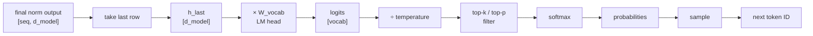
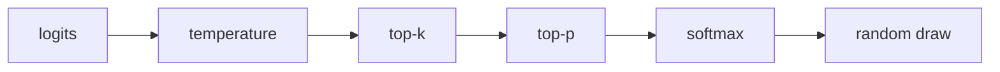

# Chapter 10 — LM Head & Sampling

> Symbols such as `seq`, `ctx` and `d_model` are defined in [Chapter 0 — Notation](ch-0-overview.md#notation).

After the last block and final norm, each token has a `d_model` vector. The LM head turns the
vector at the **last position** into a score for every word in the vocabulary, and a
sampling rule picks the next token.



## 1. LM head: hidden vector → logits

```
logits = h_last · W_vocab          W_vocab : [d_model, vocab]
```

One score ("logit") per vocabulary entry. For Llama-2-7B that is `4096 × 32000` = 131M
parameters — the same size as the embedding table (Ch 2), but a separate matrix (GPT-2 ties
the two).

During generation only the **last** position's logits are needed, because only the next token
is being predicted. In prefill the model may skip the LM head for all other positions.

## 2. Softmax: logits → probabilities

```
p_i = exp(z_i) / Σ_j exp(z_j)
```

Example with a 4-word vocabulary, logits `z = [2.0, 1.0, 0.0, −1.0]`:

```
exp(z) = [7.389, 2.718, 1.000, 0.368]     sum = 11.475
p      = [0.644, 0.237, 0.087, 0.032]
```

## 3. Decoding strategies

### Greedy

Always pick the highest-probability token: here token 0. Deterministic, but tends to repeat
itself and produce dull text.

### Temperature

Divide logits by `T` before softmax.

| `T` | Logits used | Probabilities | Effect |
|-----|-------------|---------------|--------|
| 1.0 | `[2, 1, 0, −1]` | `[0.644, 0.237, 0.087, 0.032]` | unchanged |
| 0.5 | `[4, 2, 0, −2]` | `[0.865, 0.117, 0.016, 0.002]` | sharper, more confident |
| → 0 | | all mass on the top token | same as greedy |
| > 1 | | flatter | more random, more "creative" |

### Top-k

Keep only the `k` most likely tokens, renormalize, then sample.
With `k = 2`: keep `[0.644, 0.237]` → divide by 0.881 → **`[0.731, 0.269]`**.

### Top-p (nucleus)

Keep the smallest set of top tokens whose probabilities add up to at least `p`.
With `p = 0.9`: cumulative sums are 0.644, 0.881, **0.968** → keep 3 tokens →
renormalize by 0.968 → **`[0.665, 0.245, 0.090]`**.

Top-p adapts to the shape of the distribution: when the model is confident it keeps few
tokens, when it is unsure it keeps many.



Typical chat settings are around `T = 0.7`, `top_p = 0.9`. Repetition penalties, if used, adjust
logits of already-generated tokens before this pipeline.

## 4. Code

```python
import numpy as np

def sample_next(logits, temperature=1.0, top_k=None, top_p=None, rng=np.random):
    if temperature == 0:
        return int(np.argmax(logits))                       # greedy
    z = logits / temperature
    p = np.exp(z - z.max()); p /= p.sum()
    order = np.argsort(p)[::-1]                             # most likely first
    keep = order
    if top_k is not None:
        keep = keep[:top_k]
    if top_p is not None:
        cum = np.cumsum(p[keep])
        keep = keep[: np.searchsorted(cum, top_p) + 1]
    q = p[keep] / p[keep].sum()
    return int(rng.choice(keep, p=q))

logits = np.array([2.0, 1.0, 0.0, -1.0])
print(sample_next(logits, temperature=0))                  # 0
```

## Key takeaways

- The LM head projects the last hidden vector to one logit per vocabulary token.
- Softmax turns logits into probabilities.
- Temperature reshapes the distribution; top-k and top-p cut off the unlikely tail.
- The chosen token is appended to the input for the next step (Ch 11).

## References

The most important sources for this chapter, in order of importance.

1. Holtzman, A., Buys, J., Du, L., Forbes, M., Choi, Y. (2020). *The Curious Case of Neural Text Degeneration*. ICLR 2020. [arXiv:1904.09751](https://arxiv.org/abs/1904.09751) — nucleus (top-p) sampling.
2. Fan, A., Lewis, M., Dauphin, Y. (2018). *Hierarchical Neural Story Generation*. ACL 2018. [arXiv:1805.04833](https://arxiv.org/abs/1805.04833) — top-k sampling.
3. Bengio, Y., Ducharme, R., Vincent, P., Jauvin, C. (2003). *A Neural Probabilistic Language Model*. Journal of Machine Learning Research, 3, 1137–1155. — softmax output layer over the vocabulary.
4. Press, O., Wolf, L. (2017). *Using the Output Embedding to Improve Language Models*. EACL 2017. [arXiv:1608.05859](https://arxiv.org/abs/1608.05859) — tying the LM head to the embedding.
5. Ackley, D. H., Hinton, G. E., Sejnowski, T. J. (1985). *A Learning Algorithm for Boltzmann Machines*. Cognitive Science, 9(1), 147–169. — temperature in a softmax/Boltzmann distribution.
6. Welleck, S., Kulikov, I., Roller, S., Dinan, E., Cho, K., Weston, J. (2020). *Neural Text Generation with Unlikelihood Training*. ICLR 2020. [arXiv:1908.04319](https://arxiv.org/abs/1908.04319) — repetition in generated text.
7. Meister, C., Pimentel, T., Wiher, G., Cotterell, R. (2023). *Locally Typical Sampling*. TACL. [arXiv:2202.00666](https://arxiv.org/abs/2202.00666) — typical sampling (further reading).
8. Basu, S., Ramachandran, G. S., Keskar, N. S., Varshney, L. R. (2021). *Mirostat: A Neural Text Decoding Algorithm that Directly Controls Perplexity*. ICLR 2021. [arXiv:2007.14966](https://arxiv.org/abs/2007.14966) — perplexity-controlled sampling (further reading).
9. Goodfellow, I., Bengio, Y., Courville, A. (2016). *Deep Learning*. MIT Press. https://www.deeplearningbook.org/ — textbook: softmax and likelihood.
10. Jurafsky, D., Martin, J. H. *Speech and Language Processing* (3rd ed. draft). Online textbook, https://web.stanford.edu/~jurafsky/slp3/ — textbook: decoding and sampling.

---

← [Chapter 9 — Mixture of Experts](ch-9-mixture-of-experts.md) · [Chapter 11 — The Inference Loop](ch-11-inference-loop.md) →
