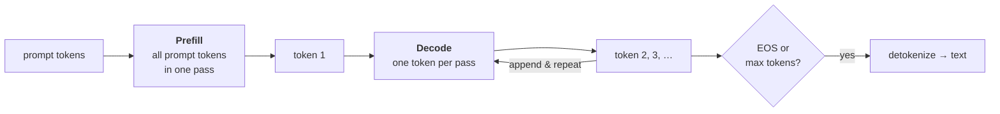
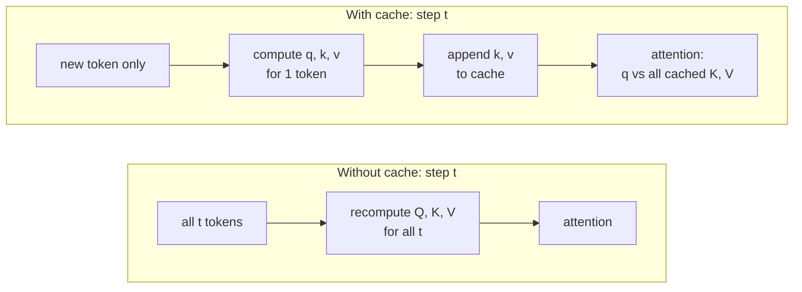

# Chapter 11 — The Inference Loop

> Symbols such as `seq`, `ctx` and `d_model` are defined in [Chapter 0 — Notation](ch-0-overview.md#notation).

An LLM produces one token per forward pass. Generating a reply is a loop: run the model,
sample a token, append it, repeat. This chapter covers the two phases of that loop and the
**KV cache** that makes it fast.

## 1. Autoregressive generation



## 2. The KV cache

Because of the causal mask (Ch 5), a token's keys and values never change once computed:
later tokens cannot affect earlier ones. So instead of recomputing `K` and `V` for the whole
sequence on every step, each layer **stores** them and appends one new row per step.



With the cache, each decode step does work proportional to **one** token for the projections
and FFN, plus one query attending over the cached keys and values.

### Cache size

```
KV bytes = 2 (K and V) × n_layers × n_kv_heads × d_h × bytes_per_value × ctx × batch

ctx   = tokens in the cache (prompt + generated so far)
batch = sequences served together
```

| Llama-2-7B, fp16 | Value |
|------------------|-------|
| per token | 2 × 32 × 32 × 128 × 2 B = 524,288 B = **512 KiB** |
| one 4,096-token sequence | **2 GiB** |

The cache grows linearly with context length and batch size and often limits how many
requests fit on a GPU. GQA (Ch 6) shrinks it by `n_kv_heads / n_heads`; storing it in 8-bit
halves it again.

## 3. Prefill vs. decode

| | Prefill | Decode |
|---|---------|--------|
| Tokens per pass (`seq`) | whole prompt (e.g. 512) | 1 per sequence |
| `ctx` after the pass | prompt length | previous `ctx` + 1 |
| Matrix shape | matrix × matrix | vector × matrix |
| Bottleneck | **compute** (FLOPs) | **memory bandwidth** |
| Metric | time to first token (TTFT) | time per output token (TPOT) |
| KV cache | written for all prompt tokens | read fully, one row appended |

### Why decode is memory-bound

At batch size 1, every decode step must read **all** the weights (plus the KV cache) from GPU
memory to produce a single token, but does only ~2 FLOPs per weight.

For Llama-2-7B in fp16:

```
weights            ≈ 6.74B params × 2 bytes ≈ 13.5 GB per step
GPU bandwidth      ≈ 2 TB/s (A100-80GB class)
upper bound        ≈ 2 TB/s ÷ 13.5 GB ≈ 148 tokens/s
```

The GPU could do far more arithmetic in that time; it is waiting on memory. In prefill the same
weights are reused for all prompt tokens, so the GPU becomes compute-bound instead (512 prompt
tokens ≈ 512 × 13.2 GFLOPs ≈ 6.8 TFLOPs of work).

## 4. Making decode faster

| Technique | Idea |
|-----------|------|
| **Batching** | Serve many sequences at once; one weight read is shared by all of them. Continuous batching adds and removes requests every step. |
| **Quantization** | Store weights (and KV cache) in 8 or 4 bits → fewer bytes to read per step. |
| **GQA / MQA** | Fewer KV heads → smaller cache to read (Ch 6). |
| **Paged KV cache** | Allocate cache in fixed-size blocks to avoid wasted memory (e.g. vLLM PagedAttention). |
| **Speculative decoding** | A small draft model proposes several tokens; the big model verifies them in one pass. |

## 5. Code

```python
def generate(model, tokenizer, prompt, max_new_tokens=100, **sampling):
    ids = tokenizer.encode(prompt)
    cache = model.new_kv_cache()
    logits = model.forward(ids, cache)              # prefill: fills cache for all prompt tokens
    out = []
    for _ in range(max_new_tokens):
        next_id = sample_next(logits[-1], **sampling)   # Ch 10
        if next_id == tokenizer.eos_id:
            break
        out.append(next_id)
        logits = model.forward([next_id], cache)    # decode: one token, cache grows by one
    return tokenizer.decode(out)
```

## Key takeaways

- Generation is a loop of one forward pass per token.
- Prefill processes the prompt at once (compute-bound); decode adds one token at a time
  (memory-bound).
- The KV cache stores past keys and values so they are never recomputed; its size grows with
  context length.
- Batching, quantization and GQA all attack the memory-bandwidth limit of decode.

## References

The most important sources for this chapter, in order of importance.

1. Pope, R., Douglas, S., Chowdhery, A., et al. (2023). *Efficiently Scaling Transformer Inference*. MLSys 2023. [arXiv:2211.05102](https://arxiv.org/abs/2211.05102) — prefill vs. decode, KV cache, memory-bound decoding.
2. Kwon, W., Li, Z., Zhuang, S., et al. (2023). *Efficient Memory Management for Large Language Model Serving with PagedAttention*. SOSP 2023. [arXiv:2309.06180](https://arxiv.org/abs/2309.06180) — PagedAttention / paged KV cache.
3. Yu, G.-I., Jeong, J. S., Kim, G.-W., Kim, S., Chun, B.-G. (2022). *Orca: A Distributed Serving System for Transformer-Based Generative Models*. OSDI 2022. — continuous (iteration-level) batching.
4. Leviathan, Y., Kalman, M., Matias, Y. (2023). *Fast Inference from Transformers via Speculative Decoding*. ICML 2023. [arXiv:2211.17192](https://arxiv.org/abs/2211.17192) — speculative decoding.
5. Williams, S., Waterman, A., Patterson, D. (2009). *Roofline: An Insightful Visual Performance Model for Multicore Architectures*. Communications of the ACM, 52(4). — the roofline model: compute- vs. memory-bound.
6. Ainslie, J., Lee-Thorp, J., de Jong, M., et al. (2023). *GQA: Training Generalized Multi-Query Transformer Models from Multi-Head Checkpoints*. EMNLP 2023. [arXiv:2305.13245](https://arxiv.org/abs/2305.13245) — shrinking the KV cache with GQA/MQA.
7. Dettmers, T., Lewis, M., Belkada, Y., Zettlemoyer, L. (2022). *LLM.int8(): 8-bit Matrix Multiplication for Transformers at Scale*. NeurIPS 2022. [arXiv:2208.07339](https://arxiv.org/abs/2208.07339) — 8-bit inference.
8. Frantar, E., Ashkboos, S., Hoefler, T., Alistarh, D. (2023). *GPTQ: Accurate Post-Training Quantization for Generative Pre-trained Transformers*. ICLR 2023. [arXiv:2210.17323](https://arxiv.org/abs/2210.17323) — 4-bit weight quantization.
9. Lin, J., Tang, J., Tang, H., et al. (2024). *AWQ: Activation-aware Weight Quantization for LLM Compression and Acceleration*. MLSys 2024. [arXiv:2306.00978](https://arxiv.org/abs/2306.00978) — activation-aware 4-bit quantization.
10. Agrawal, A., Kedia, N., Panwar, A., et al. (2024). *Taming Throughput-Latency Tradeoff in LLM Inference with Sarathi-Serve*. OSDI 2024. [arXiv:2403.02310](https://arxiv.org/abs/2403.02310) — scheduling prefill and decode together.

---

← [Chapter 10 — LM Head & Sampling](ch-10-lm-head-and-sampling.md) · [Chapter 12 — Putting It Together](ch-12-putting-it-together.md) →
