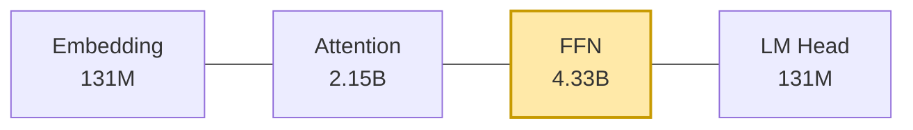

# Chapter 12 — Putting It Together

> Symbols such as `seq`, `ctx` and `d_model` are defined in [Chapter 0 — Notation](ch-0-overview.md#notation).

This chapter follows one prompt through a Llama-2-7B-sized model, tracking the shape of the
data at every step and adding up the parameters, compute and memory.

Configuration: `vocab = 32,000`, `d_model = 4,096`, `n_layers = 32`, `n_heads = 32`
(`d_h = 128`), `d_ff = 11,008`, `max_seq = 4,096`, SwiGLU, RMSNorm, RoPE, no biases, fp16 weights.

## 1. The full forward pass

## 2. Shape trace

Take a prompt that tokenizes to `seq = 6` tokens (BOS + 5 text tokens; exact IDs depend on the
tokenizer). This is prefill, so `ctx = seq = 6`.

| # | Step | Operation | Output shape |
|---|------|-----------|--------------|
| 1 | Tokenize | text → IDs (Ch 1) | `[6]` |
| 2 | Embed | row lookup in `E [32000, 4096]` (Ch 2) | `[6, 4096]` |
| | **Each of 32 blocks:** | | |
| 3 | RMSNorm | per token (Ch 4) | `[6, 4096]` |
| 4 | Q, K, V projections | `× [4096, 4096]` each | `[6, 4096]` × 3 |
| 5 | Split heads | reshape (Ch 6) | `[32, 6, 128]` × 3 |
| 6 | RoPE | rotate Q, K by position (Ch 3) | `[32, 6, 128]` |
| 7 | Store K, V | KV cache (Ch 11) | cache `[32, 6, 128]` × 2 per layer |
| 8 | Scores + mask + softmax | `Q·Kᵀ/√128` (Ch 5) | `[32, 6, 6]` |
| 9 | Weighted sum | `· V` | `[32, 6, 128]` |
| 10 | Concat + `W_O` | (Ch 6) | `[6, 4096]` |
| 11 | Residual add | `h = X + attn` (Ch 8) | `[6, 4096]` |
| 12 | RMSNorm | | `[6, 4096]` |
| 13 | Gate & up | `× [4096, 11008]` each (Ch 7) | `[6, 11008]` × 2 |
| 14 | SiLU(gate) ⊙ up | element-wise | `[6, 11008]` |
| 15 | Down | `× [11008, 4096]` | `[6, 4096]` |
| 16 | Residual add | `Y = h + ffn` | `[6, 4096]` |
| | **After all blocks:** | | |
| 17 | Final RMSNorm | | `[6, 4096]` |
| 18 | Take last position | | `[4096]` |
| 19 | LM head | `× [4096, 32000]` (Ch 10) | `[32000]` |
| 20 | Sample | temperature / top-p | 1 token ID |

Then decode starts: the new ID goes through steps 2–20 alone, with `seq = 1` for every matrix
multiply, while the attention in step 8 reads all `ctx` cached keys and values, so its scores
are `[32, 1, ctx]` (Ch 11). After the first decode step `ctx = 7`, then 8, and so on.

## 3. Parameter budget

| Component | Formula | Params | Share |
|-----------|---------|-------:|------:|
| Token embedding | 32000 · 4096 | 131,072,000 | 1.9% |
| Attention × 32 | 32 · 4 · 4096² | 2,147,483,648 | 31.9% |
| FFN × 32 | 32 · 3 · 4096 · 11008 | 4,328,521,728 | 64.2% |
| RMSNorm (64 + final) | 65 · 4096 | 266,240 | < 0.01% |
| LM head | 4096 · 32000 | 131,072,000 | 1.9% |
| **Total** | | **6,738,415,616** | **≈ 6.74B** |

## 4. Compute and memory per generated token

| Quantity | Estimate |
|----------|----------|
| FLOPs per token (matrix multiplies) | ≈ 2 × non-embedding params ≈ 2 × 6.61B ≈ **13.2 GFLOPs** |
| Extra attention FLOPs per token | ≈ 4 · ctx · d_model per layer — grows with context length `ctx` |
| Weights read per decode step (fp16) | ≈ **13.5 GB** |
| KV cache per token (fp16) | **512 KiB**; 4,096 tokens → **2 GiB** |
| Decode upper bound at 2 TB/s, batch 1 | ≈ 13.5 GB ÷ 2 TB/s → **≈ 148 tokens/s** |

The embedding lookup is a memory read, not a matrix multiply, so it is excluded from the FLOP
count; the LM head is included.

## 5. What changes in other models

| Feature | Llama-2-7B | Common variations |
|---------|-----------|-------------------|
| Positional encoding | RoPE | learned absolute (GPT-2), RoPE with longer-context scaling |
| Attention | MHA | GQA (Llama-3, Mistral), MQA, sliding-window attention |
| FFN | dense SwiGLU | MoE (Mixtral, DeepSeek) — Ch 9 |
| Norm | pre-norm RMSNorm | LayerNorm (GPT-2), extra norms on Q/K |
| Vocabulary | 32k | 128k+ (Llama-3, Qwen) — larger embedding and LM head |

The block structure — norm, attention, residual, norm, FFN, residual — stays the same.

## Key takeaways

- Text → IDs → embeddings → 32 identical-shape blocks → final norm → LM head → sample.
- Every block keeps the `[seq, d_model]` shape; only attention mixes positions.
- FFNs hold about two thirds of the weights, attention about one third.
- Decode speed is set by how fast the weights and KV cache can be read from memory.

## References

The most important sources for this chapter, in order of importance.

1. Vaswani, A., Shazeer, N., Parmar, N., et al. (2017). *Attention Is All You Need*. NeurIPS 2017. [arXiv:1706.03762](https://arxiv.org/abs/1706.03762) — the Transformer architecture.
2. Pope, R., Douglas, S., Chowdhery, A., et al. (2023). *Efficiently Scaling Transformer Inference*. MLSys 2023. [arXiv:2211.05102](https://arxiv.org/abs/2211.05102) — inference FLOPs, memory and latency analysis.
3. Brown, T., Mann, B., Ryder, N., et al. (2020). *Language Models are Few-Shot Learners*. NeurIPS 2020. [arXiv:2005.14165](https://arxiv.org/abs/2005.14165) — parameter accounting for a decoder-only LLM.
4. Chowdhery, A., Narang, S., Devlin, J., et al. (2023). *PaLM: Scaling Language Modeling with Pathways*. JMLR 24. [arXiv:2204.02311](https://arxiv.org/abs/2204.02311) — SwiGLU, RoPE and MQA in one model.
5. Su, J., Lu, Y., Pan, S., et al. (2024). *RoFormer: Enhanced Transformer with Rotary Position Embedding*. Neurocomputing. [arXiv:2104.09864](https://arxiv.org/abs/2104.09864) — RoPE.
6. Zhang, B., Sennrich, R. (2019). *Root Mean Square Layer Normalization*. NeurIPS 2019. [arXiv:1910.07467](https://arxiv.org/abs/1910.07467) — RMSNorm.
7. Ainslie, J., Lee-Thorp, J., de Jong, M., et al. (2023). *GQA: Training Generalized Multi-Query Transformer Models from Multi-Head Checkpoints*. EMNLP 2023. [arXiv:2305.13245](https://arxiv.org/abs/2305.13245) — GQA variant.
8. Fedus, W., Zoph, B., Shazeer, N. (2022). *Switch Transformers: Scaling to Trillion Parameter Models with Simple and Efficient Sparsity*. JMLR 23. [arXiv:2101.03961](https://arxiv.org/abs/2101.03961) — MoE variant.
9. Raschka, S. (2024). *Build a Large Language Model (From Scratch)*. Manning. — textbook: implementing the full model.
10. Jurafsky, D., Martin, J. H. *Speech and Language Processing* (3rd ed. draft). Online textbook, https://web.stanford.edu/~jurafsky/slp3/ — textbook: transformers and LLMs.

---

← [Chapter 11 — The Inference Loop](ch-11-inference-loop.md) · [Chapter 0 — Overview](ch-0-overview.md)
