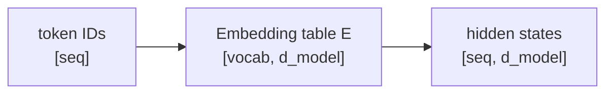

# Chapter 2 — Token Embedding

> Symbols such as `seq`, `ctx` and `d_model` are defined in [Chapter 0 — Notation](ch-0-overview.md#notation).

Token IDs are just labels: ID 500 is not "bigger" than ID 499. The embedding layer turns
each ID into a dense vector of `d_model` numbers that the rest of the network can compute
with.



## 1. It is a table lookup

The embedding is a learned matrix `E` of shape `[vocab, d_model]`. Token `t` is represented
by row `t` of that matrix:

```
x = E[t]          # one row, shape [d_model]
```

Mathematically this is the same as multiplying a one-hot vector by `E`, but no
multiplication happens in practice — it is just indexing.

```
            E  [vocab × d_model]
          ┌───────────────────────┐
 row 0    │  ...                  │
 row 1    │  ...                  │
 row t ──▶│ 0.12 -0.40  ...  0.07 │ ──▶ x  [d_model]
 ...      │  ...                  │
          └───────────────────────┘
```

For a prompt of `seq` tokens, the output is a `[seq, d_model]` matrix — one row per token.
This matrix is the **residual stream** that flows through all the decoder blocks.

## 2. Tiny example

`vocab = 4`, `d_model = 3`:

```
E = [[ 0.0,  0.0,  0.0],   # id 0
     [ 1.0,  0.5, -1.0],   # id 1
     [ 0.2, -0.3,  0.8],   # id 2
     [-0.6,  0.9,  0.1]]   # id 3

ids = [2, 1, 2]
X   = [[ 0.2, -0.3,  0.8],
       [ 1.0,  0.5, -1.0],
       [ 0.2, -0.3,  0.8]]   # shape [3, 3]
```

Note that both copies of token 2 get the **same** vector. The embedding carries no
information about position — that is the job of Chapter 3.

## 3. Size (Llama-2-7B)

| Quantity            | Formula           | Value                |
|---------------------|-------------------|----------------------|
| Embedding params    | vocab × d_model   | 32,000 × 4,096 = 131,072,000 (≈ 131M) |
| Memory (fp16)       | × 2 bytes         | ≈ 262 MB             |
| Compute per token   | —                 | none (a memory read of one row) |

That is about 2% of the model's 6.74B parameters.

## 4. What the vectors learn

The table starts random and is trained with the rest of the model. Tokens used in similar
contexts end up with similar vectors, so directions in this space come to encode meaning
(e.g. related words cluster together). The original Transformer also multiplied embeddings by
`√d_model`; Llama does not.

**Weight tying**: some models (GPT-2) reuse `E` as the output projection in the LM head
(Ch 10), saving `vocab × d_model` parameters. Llama-2 keeps them separate.

## 5. Code

```python
import numpy as np

E   = np.random.randn(32000, 4096).astype(np.float16)   # learned in practice
ids = np.array([1, 450, 6635])                           # example IDs
X   = E[ids]                                             # [3, 4096]
```

## Key takeaways

- Embedding = row lookup in a `[vocab, d_model]` table.
- Output is the `[seq, d_model]` residual stream used by every later layer.
- Same token → same vector; position is added separately.

## References

The most important sources for this chapter, in order of importance.

1. Bengio, Y., Ducharme, R., Vincent, P., Jauvin, C. (2003). *A Neural Probabilistic Language Model*. Journal of Machine Learning Research, 3, 1137–1155. — learned word embeddings in a neural LM.
2. Vaswani, A., Shazeer, N., Parmar, N., et al. (2017). *Attention Is All You Need*. NeurIPS 2017. [arXiv:1706.03762](https://arxiv.org/abs/1706.03762) — learned embeddings, √d_model scaling, shared weights.
3. Mikolov, T., Sutskever, I., Chen, K., Corrado, G., Dean, J. (2013). *Distributed Representations of Words and Phrases and their Compositionality*. NeurIPS 2013. [arXiv:1310.4546](https://arxiv.org/abs/1310.4546) — word vectors capturing meaning.
4. Pennington, J., Socher, R., Manning, C. D. (2014). *GloVe: Global Vectors for Word Representation*. EMNLP 2014. — word vectors from co-occurrence statistics.
5. Press, O., Wolf, L. (2017). *Using the Output Embedding to Improve Language Models*. EACL 2017. [arXiv:1608.05859](https://arxiv.org/abs/1608.05859) — weight tying of input and output embeddings.
6. Inan, H., Khosravi, K., Socher, R. (2017). *Tying Word Vectors and Word Classifiers: A Loss Framework for Language Modeling*. ICLR 2017. [arXiv:1611.01462](https://arxiv.org/abs/1611.01462) — weight tying, theoretical motivation.
7. Jurafsky, D., Martin, J. H. *Speech and Language Processing* (3rd ed. draft). Online textbook, https://web.stanford.edu/~jurafsky/slp3/ — textbook: vector semantics and embeddings.
8. Goodfellow, I., Bengio, Y., Courville, A. (2016). *Deep Learning*. MIT Press. https://www.deeplearningbook.org/ — textbook: representation learning.
9. Zhang, A., Lipton, Z. C., Li, M., Smola, A. J. (2023). *Dive into Deep Learning*. Cambridge University Press. https://d2l.ai/ — textbook: embedding layers.

---

← [Chapter 1 — Tokenizer](ch-1-tokenizer.md) · [Chapter 3 — Positional Encoding](ch-3-positional-encoding.md) →
