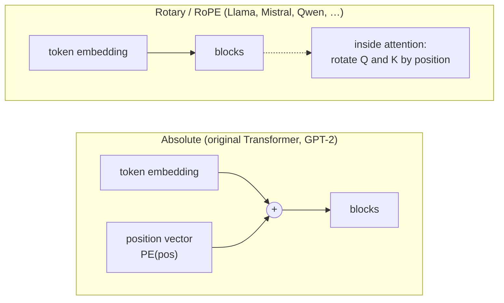
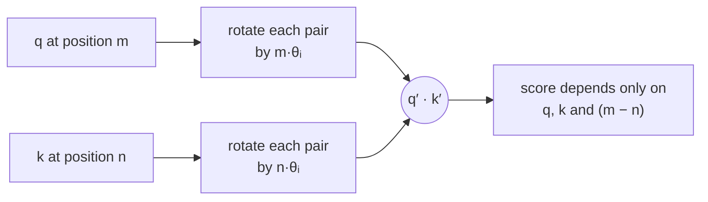

# Chapter 3 — Positional Encoding

> Symbols such as `seq`, `ctx` and `d_model` are defined in [Chapter 0 — Notation](ch-0-overview.md#notation).

Attention (Ch 5) compares every token with every other token, but on its own it treats the
input as an unordered **set**: "dog bites man" and "man bites dog" would look identical. Word
order must be injected explicitly.

There are two main families:



## 1. Absolute positional encoding

A vector `PE(pos)` of size `d_model` is **added** to the token embedding once, before the first
block:

```
x_pos = E[token] + PE(pos)
```

**Sinusoidal** (original Transformer), for dimension pair `i`:

```
PE(pos, 2i)   = sin(pos / 10000^(2i/d_model))
PE(pos, 2i+1) = cos(pos / 10000^(2i/d_model))
```

Low dimensions oscillate fast, high dimensions slowly — like the hands of a clock.
**Learned** absolute embeddings (GPT-2) instead use a trainable `[max_seq, d_model]` table.
Either way the model only knows absolute positions, and learned tables cannot go beyond
`max_seq`.

## 2. Rotary Position Embedding (RoPE)

RoPE does not touch the embeddings. Instead, inside **every** attention layer, it rotates the
query and key vectors by an angle proportional to their position. Values `V` are not rotated.

Split a head's vector (head dim `d_h`) into `d_h/2` pairs. Pair `i` of the vector at position
`m` is rotated by angle `m·θ_i`:

```
θ_i = 10000^(-2i / d_h)

[x'_{2i}  ]   [ cos mθ_i   -sin mθ_i ] [x_{2i}  ]
[x'_{2i+1}] = [ sin mθ_i    cos mθ_i ] [x_{2i+1}]
```



### Why it works: relative position for free

Rotating `q` by `mθ` and `k` by `nθ` and taking their dot product gives the same result as
rotating only `k` by `(n − m)θ`:

```
R(mθ)q · R(nθ)k  =  q · R((n−m)θ)k
```

So attention scores depend on the **distance** between tokens, not their absolute positions.
Example in 2-D with `θ = 90°`: `q` at position 2 and `k` at position 1 give the same score as
`q` at position 5 and `k` at position 4, because both pairs are 1 apart.

### Frequencies (Llama-2-7B, `d_h = 128`)

| Pair `i` | `θ_i`     | Behaviour |
|----------|-----------|-----------|
| 0        | 1.0       | rotates fast — sensitive to nearby tokens |
| 1        | ≈ 0.866   |           |
| 63       | ≈ 0.000115 | rotates very slowly — tracks long distances |

Implementation note: Hugging Face's Llama pairs dimension `j` with `j + d_h/2` ("rotate half")
instead of adjacent dimensions. It is the same idea with a different memory layout.

## 3. Code

```python
import numpy as np

def rope(x, pos, base=10000.0):
    # x: [seq, d_h], pos: [seq]
    d_h = x.shape[-1]
    theta = base ** (-np.arange(0, d_h, 2) / d_h)          # [d_h/2]
    ang = pos[:, None] * theta[None, :]                    # [seq, d_h/2]
    cos, sin = np.cos(ang), np.sin(ang)
    x1, x2 = x[:, 0::2], x[:, 1::2]
    out = np.empty_like(x)
    out[:, 0::2] = x1 * cos - x2 * sin
    out[:, 1::2] = x1 * sin + x2 * cos
    return out
```

## Key takeaways

- Attention alone is order-blind; position must be added.
- Absolute encodings add a position vector to the embedding once.
- RoPE rotates Q and K in every attention layer, so scores depend on relative distance.
- RoPE has no learned parameters and is used by most current open LLMs.

## References

The most important sources for this chapter, in order of importance.

1. Su, J., Lu, Y., Pan, S., et al. (2024). *RoFormer: Enhanced Transformer with Rotary Position Embedding*. Neurocomputing. [arXiv:2104.09864](https://arxiv.org/abs/2104.09864) — RoPE.
2. Vaswani, A., Shazeer, N., Parmar, N., et al. (2017). *Attention Is All You Need*. NeurIPS 2017. [arXiv:1706.03762](https://arxiv.org/abs/1706.03762) — sinusoidal positional encoding.
3. Gehring, J., Auli, M., Grangier, D., Yarats, D., Dauphin, Y. N. (2017). *Convolutional Sequence to Sequence Learning*. ICML 2017. [arXiv:1705.03122](https://arxiv.org/abs/1705.03122) — learned absolute position embeddings.
4. Chowdhery, A., Narang, S., Devlin, J., et al. (2023). *PaLM: Scaling Language Modeling with Pathways*. JMLR 24. [arXiv:2204.02311](https://arxiv.org/abs/2204.02311) — RoPE in a large decoder-only LLM.
5. Shaw, P., Uszkoreit, J., Vaswani, A. (2018). *Self-Attention with Relative Position Representations*. NAACL 2018. [arXiv:1803.02155](https://arxiv.org/abs/1803.02155) — relative position representations.
6. Ke, G., He, D., Liu, T.-Y. (2021). *Rethinking Positional Encoding in Language Pre-training*. ICLR 2021. [arXiv:2006.15595](https://arxiv.org/abs/2006.15595) — analysis of absolute vs. relative position encodings.
7. Press, O., Smith, N. A., Lewis, M. (2022). *Train Short, Test Long: Attention with Linear Biases Enables Input Length Extrapolation*. ICLR 2022. [arXiv:2108.12409](https://arxiv.org/abs/2108.12409) — ALiBi (further reading).
8. Peng, B., Quesnelle, J., Fan, H., Shippole, E. (2024). *YaRN: Efficient Context Window Extension of Large Language Models*. ICLR 2024. [arXiv:2309.00071](https://arxiv.org/abs/2309.00071) — extending RoPE to longer contexts.
9. Kazemnejad, A., Padhi, I., Natesan Ramamurthy, K., Das, P., Reddy, S. (2023). *The Impact of Positional Encoding on Length Generalization in Transformers*. NeurIPS 2023. [arXiv:2305.19466](https://arxiv.org/abs/2305.19466) — positional encodings and length generalization.
10. Zhang, A., Lipton, Z. C., Li, M., Smola, A. J. (2023). *Dive into Deep Learning*. Cambridge University Press. https://d2l.ai/ — textbook: positional encoding.

---

← [Chapter 2 — Token Embedding](ch-2-token-embedding.md) · [Chapter 4 — Normalization](ch-4-normalization.md) →
