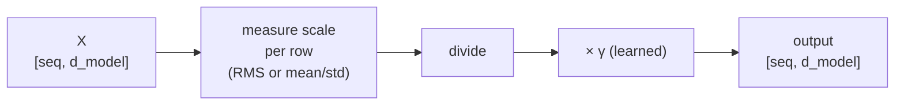
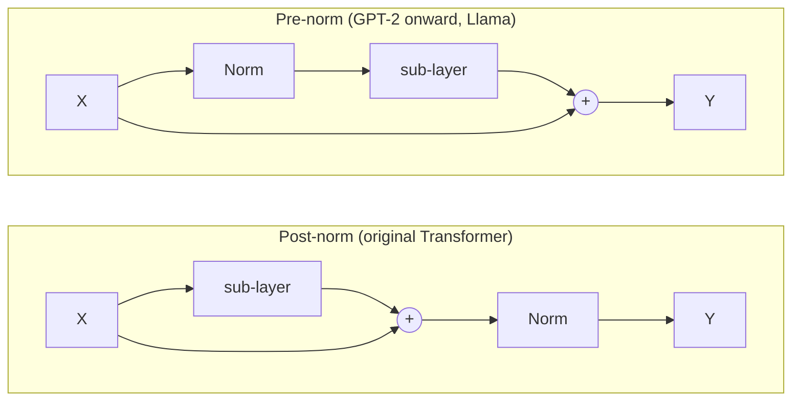

# Chapter 4 — Normalization

> Symbols such as `seq`, `ctx` and `d_model` are defined in [Chapter 0 — Notation](ch-0-overview.md#notation).

As a vector passes through dozens of layers, its values can drift to very large or very
small scales, which makes training unstable. A normalization layer rescales each token's
vector to a standard size before it enters attention or the FFN.



The input is the residual stream `X : [seq, d_model]`, and the output has the same shape.
Normalization works on **each row (token) separately**, across its `d_model` features, so the
formulas below are written for one row `x : [d_model]`.

## 1. LayerNorm (original Transformer, GPT-2, BERT)

```
μ  = mean(x)
σ² = mean((x − μ)²)
y  = (x − μ) / √(σ² + ε) · γ + β
```

Centres the vector to mean 0, scales it to variance 1, then applies a learned scale `γ` and
shift `β` (each `[d_model]`).

## 2. RMSNorm (Llama, Mistral, Qwen, DeepSeek, …)

```
rms = √( mean(x²) + ε )
y   = x / rms · γ
```

No mean subtraction and no `β`. It is cheaper and works just as well in practice, so nearly
all modern LLMs use it. Llama-2 uses `ε = 1e-5`.

## 3. Worked example

`x = [1, 2, 3, 4]`, `γ = 1`, `β = 0`, ignoring `ε`:

| Step | LayerNorm | RMSNorm |
|------|-----------|---------|
| statistic | μ = 2.5, σ² = 1.25, σ ≈ 1.118 | mean(x²) = (1+4+9+16)/4 = 7.5, rms ≈ 2.739 |
| output    | [−1.342, −0.447, 0.447, 1.342] | [0.365, 0.730, 1.095, 1.461] |

LayerNorm output has mean 0; RMSNorm output keeps the sign pattern of `x` but has
root-mean-square 1.

## 4. Pre-norm vs. post-norm

Where the norm sits relative to the residual connection matters:



- **Post-norm**: `Y = Norm(X + Sublayer(X))`. Every output passes through a norm, which can make
  deep stacks hard to train.
- **Pre-norm**: `Y = X + Sublayer(Norm(X))`. The residual path from input to output is an
  untouched sum, so signals and gradients flow easily through many layers. Because the
  residual stream itself is never normalized, a **final norm** is applied after the last block
  (Ch 8).

## 5. Cost (Llama-2-7B)

Each block has two RMSNorms, plus one final norm: `32 × 2 × 4,096 + 4,096 = 266,240`
parameters — negligible next to 6.74B. Compute is also tiny (a few operations per element),
but it touches every activation, so fast kernels often fuse it with the next matrix multiply.

## 6. Code

```python
import numpy as np

def layer_norm(x, gamma, beta, eps=1e-5):
    mu = x.mean(-1, keepdims=True)
    var = ((x - mu) ** 2).mean(-1, keepdims=True)
    return (x - mu) / np.sqrt(var + eps) * gamma + beta

def rms_norm(x, gamma, eps=1e-5):
    return x / np.sqrt((x ** 2).mean(-1, keepdims=True) + eps) * gamma
```

## Key takeaways

- Normalization rescales each token's vector to a standard size.
- RMSNorm = divide by root-mean-square, then scale by `γ`. Modern LLMs use it.
- Pre-norm places the norm before each sub-layer, leaving the residual path clean.

## References

The most important sources for this chapter, in order of importance.

1. Zhang, B., Sennrich, R. (2019). *Root Mean Square Layer Normalization*. NeurIPS 2019. [arXiv:1910.07467](https://arxiv.org/abs/1910.07467) — RMSNorm (also restates LayerNorm).
2. Xiong, R., Yang, Y., He, D., et al. (2020). *On Layer Normalization in the Transformer Architecture*. ICML 2020. [arXiv:2002.04745](https://arxiv.org/abs/2002.04745) — LayerNorm placement: pre-norm vs. post-norm.
3. Liu, L., Liu, X., Gao, J., Chen, W., Han, J. (2020). *Understanding the Difficulty of Training Transformers*. EMNLP 2020. [arXiv:2004.08249](https://arxiv.org/abs/2004.08249) — why post-norm Transformers are hard to train.
4. Vaswani, A., Shazeer, N., Parmar, N., et al. (2017). *Attention Is All You Need*. NeurIPS 2017. [arXiv:1706.03762](https://arxiv.org/abs/1706.03762) — post-norm in the original Transformer.
5. Wang, Q., Li, B., Xiao, T., et al. (2019). *Learning Deep Transformer Models for Machine Translation*. ACL 2019. [arXiv:1906.01787](https://arxiv.org/abs/1906.01787) — pre-norm for deep Transformers.
6. Brown, T., Mann, B., Ryder, N., et al. (2020). *Language Models are Few-Shot Learners*. NeurIPS 2020. [arXiv:2005.14165](https://arxiv.org/abs/2005.14165) — pre-norm in a large decoder-only LLM.
7. Dehghani, M., Djolonga, J., Mustafa, B., et al. (2023). *Scaling Vision Transformers to 22 Billion Parameters*. ICML 2023. [arXiv:2302.05442](https://arxiv.org/abs/2302.05442) — normalizing Q and K for stability.
8. Ioffe, S., Szegedy, C. (2015). *Batch Normalization: Accelerating Deep Network Training by Reducing Internal Covariate Shift*. ICML 2015. [arXiv:1502.03167](https://arxiv.org/abs/1502.03167) — background: batch normalization.
9. Zhang, A., Lipton, Z. C., Li, M., Smola, A. J. (2023). *Dive into Deep Learning*. Cambridge University Press. https://d2l.ai/ — textbook: layer normalization.
10. Goodfellow, I., Bengio, Y., Courville, A. (2016). *Deep Learning*. MIT Press. https://www.deeplearningbook.org/ — textbook: normalization and optimization.

---

← [Chapter 3 — Positional Encoding](ch-3-positional-encoding.md) · [Chapter 5 — Self-Attention](ch-5-self-attention.md) →
