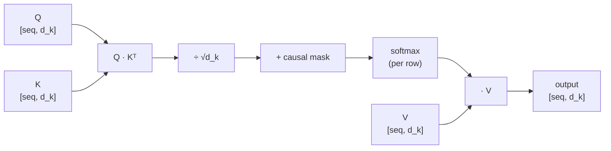

# Chapter 5 — Self-Attention

> Symbols such as `seq`, `ctx` and `d_model` are defined in [Chapter 0 — Notation](ch-0-overview.md#notation).

Attention is the only place where tokens exchange information. Each token asks a question
("what am I looking for?"), compares it with every earlier token's label ("what do I
contain?"), and gathers a weighted mix of their contents.

## 1. Queries, keys and values

Each token's (normalized) hidden vector `x` is projected three ways:

```
Q = X · W_Q     "what am I looking for?"
K = X · W_K     "what do I offer?"
V = X · W_V     "what do I pass on if chosen?"
```

With `X : [seq, d_model]` and each `W : [d_model, d_k]`, the results are `[seq, d_k]`.
In a real model `d_k` is the head dimension `d_h` (128 in the running example); Ch 6 explains
how `d_model` is split into heads.
In a real model RoPE (Ch 3) is applied to `Q` and `K` at this point.

## 2. Scaled dot-product attention

```
Attention(Q, K, V) = softmax( Q · Kᵀ / √d_k  +  mask ) · V
```



| Step | Shape | Meaning |
|------|-------|---------|
| `Q · Kᵀ` | `[seq, seq]` | score of every query against every key |
| `÷ √d_k` | `[seq, seq]` | keeps scores from growing with `d_k`, so softmax is not saturated |
| `+ mask` | `[seq, seq]` | forbids looking at future tokens |
| `softmax` | `[seq, seq]` | each row becomes weights summing to 1 |
| `· V` | `[seq, d_k]` | each token's output is a weighted average of value vectors |

The shapes above are for **prefill**, where all `seq` tokens are processed together and
`ctx = seq`. In **decode**, `Q` has 1 row (the new token) while `K` and `V` have `ctx` rows
(read from the KV cache, Ch 11), so the scores are `[1, ctx]` and the output is `[1, d_k]`.

## 3. The causal mask

A language model predicts the next token, so token `i` may only attend to tokens `0 … i`.
The mask adds `−∞` above the diagonal; after softmax those weights become 0.

```
            key →   t0    t1    t2    t3
query  t0  [  ✓    −∞    −∞    −∞ ]
  ↓    t1  [  ✓     ✓    −∞    −∞ ]
       t2  [  ✓     ✓     ✓    −∞ ]
       t3  [  ✓     ✓     ✓     ✓ ]
```

This is what makes the KV cache possible (Ch 11): earlier tokens never change when new tokens
arrive, so their keys and values can be stored and reused.

## 4. Worked example

Two tokens, `d_k = 2` (projections already applied):

```
Q = [[1, 0],      K = [[1, 0],      V = [[1,  0],
     [1, 1]]           [0, 1]]           [0, 10]]
```

```
step 1  Q · Kᵀ          = [[1, 0],
                           [1, 1]]
step 2  ÷ √2            = [[0.707, 0    ],
                           [0.707, 0.707]]
step 3  + causal mask   = [[0.707, −∞   ],
                           [0.707, 0.707]]
step 4  softmax rows    = [[1.0, 0.0],
                           [0.5, 0.5]]
step 5  · V             = [[1.0,       0.0],          # token 0 sees only itself
                           [0.5·1+0.5·0, 0.5·0+0.5·10]]
                        = [[1.0, 0.0],
                           [0.5, 5.0]]
```

Token 1 scored both keys equally, so its output is the average of both value vectors.

## 5. Cost

Per layer, in prefill (`ctx = seq`):

- Projections: linear in `seq` (`~2 · seq · d_model²` FLOPs each).
- Scores and weighted sum: `~4 · seq² · d_model` FLOPs — **quadratic** in sequence length. This is why
  long contexts are expensive, and why kernels like FlashAttention compute it in tiles
  without materializing the full `[seq, seq]` matrix.
- During decode (`seq = 1`, one new query), the score step is `~4 · ctx · d_model` FLOPs, but it must read the
  whole KV cache from memory.

## 6. Code

```python
import numpy as np

def softmax(z):
    z = z - z.max(-1, keepdims=True)
    e = np.exp(z)
    return e / e.sum(-1, keepdims=True)

def causal_attention(Q, K, V):
    seq, d_k = Q.shape
    scores = Q @ K.T / np.sqrt(d_k)
    mask = np.triu(np.ones((seq, seq), dtype=bool), k=1)
    scores[mask] = -np.inf
    return softmax(scores) @ V

Q = np.array([[1., 0.], [1., 1.]])
K = np.array([[1., 0.], [0., 1.]])
V = np.array([[1., 0.], [0., 10.]])
print(causal_attention(Q, K, V))      # [[1.  0. ] [0.5 5. ]]
```

## Key takeaways

- Attention mixes information across positions; it is the only layer that does.
- `softmax(QKᵀ/√d_k + mask) · V`: score, normalize, take a weighted average.
- The causal mask restricts each token to itself and earlier tokens.
- Cost grows quadratically with sequence length.

## References

The most important sources for this chapter, in order of importance.

1. Vaswani, A., Shazeer, N., Parmar, N., et al. (2017). *Attention Is All You Need*. NeurIPS 2017. [arXiv:1706.03762](https://arxiv.org/abs/1706.03762) — scaled dot-product attention, causal masking.
2. Bahdanau, D., Cho, K., Bengio, Y. (2015). *Neural Machine Translation by Jointly Learning to Align and Translate*. ICLR 2015. [arXiv:1409.0473](https://arxiv.org/abs/1409.0473) — the original attention mechanism.
3. Luong, M.-T., Pham, H., Manning, C. D. (2015). *Effective Approaches to Attention-based Neural Machine Translation*. EMNLP 2015. [arXiv:1508.04025](https://arxiv.org/abs/1508.04025) — dot-product attention.
4. Dao, T., Fu, D. Y., Ermon, S., Rudra, A., Ré, C. (2022). *FlashAttention: Fast and Memory-Efficient Exact Attention with IO-Awareness*. NeurIPS 2022. [arXiv:2205.14135](https://arxiv.org/abs/2205.14135) — FlashAttention: tiled exact attention.
5. Dao, T. (2024). *FlashAttention-2: Faster Attention with Better Parallelism and Work Partitioning*. ICLR 2024. [arXiv:2307.08691](https://arxiv.org/abs/2307.08691) — FlashAttention-2.
6. Jurafsky, D., Martin, J. H. *Speech and Language Processing* (3rd ed. draft). Online textbook, https://web.stanford.edu/~jurafsky/slp3/ — textbook: self-attention.
7. Zhang, A., Lipton, Z. C., Li, M., Smola, A. J. (2023). *Dive into Deep Learning*. Cambridge University Press. https://d2l.ai/ — textbook: attention mechanisms with code.
8. Goodfellow, I., Bengio, Y., Courville, A. (2016). *Deep Learning*. MIT Press. https://www.deeplearningbook.org/ — textbook: softmax and sequence models.

---

← [Chapter 4 — Normalization](ch-4-normalization.md) · [Chapter 6 — Multi-Head Attention](ch-6-multi-head-attention.md) →
