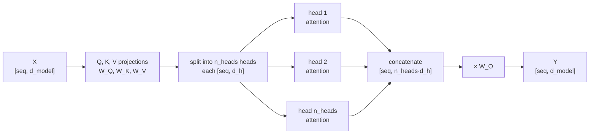
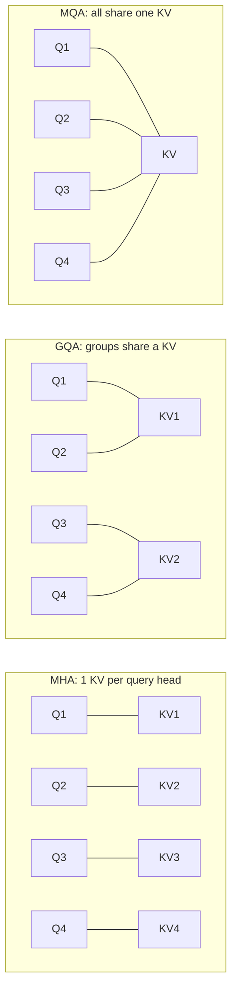

# Chapter 6 — Multi-Head Attention

> Symbols such as `seq`, `ctx` and `d_model` are defined in [Chapter 0 — Notation](ch-0-overview.md#notation).

A single attention pattern can focus on only one kind of relationship at a time. Multi-head
attention runs several attention operations ("heads") in parallel, each with its own smaller
`Q`, `K`, `V`, so different heads can track different things — the previous token, the
subject of the sentence, a matching bracket, and so on.

## 1. Split, attend, concatenate, project



```
Q, K, V = X·W_Q, X·W_K, X·W_V                 each [seq, d_model]
split each into n_heads heads                 each head [seq, d_h],  d_h = d_model / n_heads
head_j  = Attention(Q_j, K_j, V_j)            (Ch 5, with RoPE on Q_j, K_j)
MHA(X)  = concat(head_1 … head_{n_heads}) · W_O
```

The split is just a reshape — no extra computation. `W_O` (`[d_model, d_model]`) mixes the
heads' outputs back into the residual stream.

## 2. Shapes (Llama-2-7B)

`d_model = 4096`, `n_heads = 32`, `d_h = 128`.

| Tensor | Shape |
|--------|-------|
| `W_Q`, `W_K`, `W_V`, `W_O` | `[4096, 4096]` each |
| `Q` after reshape | `[32 heads, seq, 128]` |
| `K`, `V` used by attention (incl. KV cache) | `[32 heads, ctx, 128]` |
| scores per head | `[seq, ctx]` (`[seq, seq]` in prefill, `[1, ctx]` in decode) |
| output after concat | `[seq, 4096]` |

Parameters per layer: `4 × 4096² = 67,108,864` (≈ 67M). Over 32 layers: ≈ 2.15B.

Splitting into heads does **not** change the parameter count or the projection FLOPs compared
with one big head; it only changes how the attention scores are computed.

## 3. MQA and GQA: sharing keys and values

During decoding, every layer must store the `K` and `V` of all previous tokens (the KV cache,
Ch 11). With full multi-head attention, every head has its own `K` and `V`, so the cache is
large. Two variants shrink it by letting query heads **share** key/value heads:



| Variant | KV heads | KV cache size | Used by |
|---------|----------|---------------|---------|
| MHA | `n_heads` | 1× | Llama-2-7B / 13B |
| GQA | `n_kv_heads`, with `1 < n_kv_heads < n_heads` | `n_kv_heads / n_heads` × | Llama-2-70B (64 Q heads, 8 KV heads → 8× smaller), Llama-3, Mistral |
| MQA | 1 | `1 / n_heads` × | PaLM, Falcon |

GQA keeps quality close to MHA while cutting cache memory and the bandwidth needed to read it
on every decode step. `W_K` and `W_V` shrink to `[d_model, n_kv_heads · d_h]`.

## 4. Code

```python
import numpy as np

def mha(X, W_Q, W_K, W_V, W_O, n_heads, attn):
    seq, d = X.shape
    d_h = d // n_heads
    def split(M):                                   # [seq, d_model] -> [n_heads, seq, d_h]
        return M.reshape(seq, n_heads, d_h).transpose(1, 0, 2)
    Q, K, V = split(X @ W_Q), split(X @ W_K), split(X @ W_V)
    heads = [attn(Q[j], K[j], V[j]) for j in range(n_heads)]   # Ch 5 causal_attention
    return np.concatenate(heads, axis=-1) @ W_O
```

## Key takeaways

- `n_heads` heads each attend in a `d_h = d_model / n_heads` subspace, then `W_O` merges them.
- Same parameter count as one big head; more varied attention patterns.
- GQA/MQA share K/V heads to shrink the KV cache, which matters most at inference.

## References

The most important sources for this chapter, in order of importance.

1. Vaswani, A., Shazeer, N., Parmar, N., et al. (2017). *Attention Is All You Need*. NeurIPS 2017. [arXiv:1706.03762](https://arxiv.org/abs/1706.03762) — multi-head attention.
2. Ainslie, J., Lee-Thorp, J., de Jong, M., et al. (2023). *GQA: Training Generalized Multi-Query Transformer Models from Multi-Head Checkpoints*. EMNLP 2023. [arXiv:2305.13245](https://arxiv.org/abs/2305.13245) — grouped-query attention (GQA), with multi-query attention (MQA) as a special case.
3. Chowdhery, A., Narang, S., Devlin, J., et al. (2023). *PaLM: Scaling Language Modeling with Pathways*. JMLR 24. [arXiv:2204.02311](https://arxiv.org/abs/2204.02311) — MQA in a large LLM.
4. Pope, R., Douglas, S., Chowdhery, A., et al. (2023). *Efficiently Scaling Transformer Inference*. MLSys 2023. [arXiv:2211.05102](https://arxiv.org/abs/2211.05102) — why MQA/GQA matter for decode memory bandwidth.
5. Michel, P., Levy, O., Neubig, G. (2019). *Are Sixteen Heads Really Better than One?* NeurIPS 2019. [arXiv:1905.10650](https://arxiv.org/abs/1905.10650) — how many heads are needed.
6. Voita, E., Talbot, D., Moiseev, F., Sennrich, R., Titov, I. (2019). *Analyzing Multi-Head Self-Attention: Specialized Heads Do the Heavy Lifting, the Rest Can Be Pruned*. ACL 2019. [arXiv:1905.09418](https://arxiv.org/abs/1905.09418) — what individual heads specialize in.
7. Zhang, A., Lipton, Z. C., Li, M., Smola, A. J. (2023). *Dive into Deep Learning*. Cambridge University Press. https://d2l.ai/ — textbook: multi-head attention.
8. Jurafsky, D., Martin, J. H. *Speech and Language Processing* (3rd ed. draft). Online textbook, https://web.stanford.edu/~jurafsky/slp3/ — textbook: multi-head attention.

---

← [Chapter 5 — Self-Attention](ch-5-self-attention.md) · [Chapter 7 — Feed-Forward Network](ch-7-feed-forward-network.md) →
