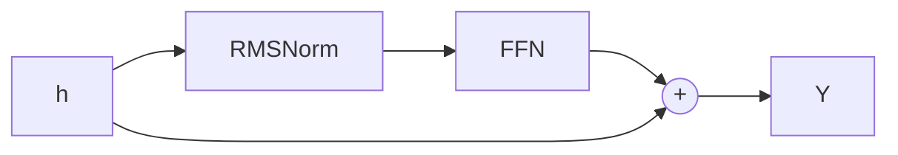
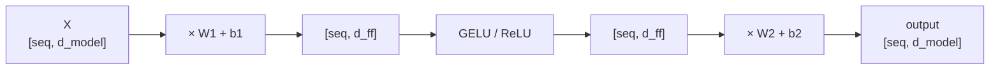
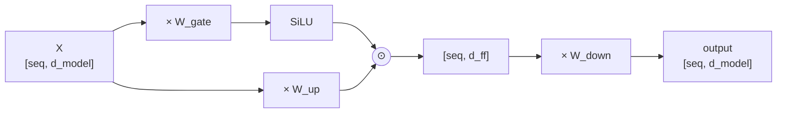

# Chapter 7 — Feed-Forward Network (FFN)

> Symbols such as `seq`, `ctx` and `d_model` are defined in [Chapter 0 — Notation](ch-0-overview.md#notation).

After attention has mixed information across tokens, the FFN processes **each token on its
own**: it expands the vector to a wider space, applies a non-linearity, and projects it back.
The FFN holds about two thirds of a dense model's parameters, so most of what the model
"knows" is stored here.



```
Y = h + FFN(RMSNorm(h))
```

## 1. Classic FFN (original Transformer, GPT-2, BERT)

```
FFN(X) = act(X · W1 + b1) · W2 + b2
```

| Tensor | Shape | Role |
|--------|-------|------|
| `X`    | `[seq, d_model]` | input from the attention sub-layer (after RMSNorm): one row per token |
| `x`    | `[d_model]` | one row of `X` = one token's hidden vector |
| `W1`   | `[d_model, d_ff]` | up-projection (expand) |
| `act`  | — | ReLU or GELU, element-wise |
| `W2`   | `[d_ff, d_model]` | down-projection (contract) |
| output | `[seq, d_model]` | same shape as `X` |

> **Input is `[seq, d_model]`, but each row is processed independently with the same
> weights.** Row `i` of `X · W1` depends only on row `i` of `X`, and the activation is
> element-wise, so `FFN(X)` is exactly `FFN(x)` applied to each token's row `x` separately.
> That is why the FFN is often described per token with `x : [d_model]`. In practice all rows
> go through as one matrix multiply. (Contrast: attention output row `i` depends on many rows.)

Usually `d_ff = 4 · d_model` (GPT-2 small: 768 → 3072 → 768).



The wide hidden layer acts like a bank of feature detectors; the activation decides which ones
fire for this token, and `W2` writes the fired features back into the residual stream.

## 2. Gated FFN — SwiGLU (Llama, Mistral, Qwen, DeepSeek, …)

Modern LLMs use two parallel up-projections: one passes through SiLU and acts as a **gate**,
the other is the **value**. They are multiplied element-wise, then projected down. No biases.

```
gate   = SiLU(X · W_gate)        SiLU(z) = z · sigmoid(z)
up     =      X · W_up
FFN(X) = (gate ⊙ up) · W_down     ⊙ = element-wise multiply
```



| Tensor | Shape |
|--------|-------|
| `X` (input) | `[seq, d_model]` |
| `W_gate` | `[d_model, d_ff]` |
| `W_up`   | `[d_model, d_ff]` |
| `gate`, `up`, `gate ⊙ up` | `[seq, d_ff]` |
| `W_down` | `[d_ff, d_model]` |
| output | `[seq, d_model]` |

As with the classic FFN, every operation is per row: each token goes through the same three
matrices on its own.

**Why `d_ff ≈ 8/3 · d_model`?** Three matrices instead of two. To match the parameter count
of a classic `4·d_model` FFN: `3 · d · d_ff = 2 · d · 4d → d_ff = 8d/3`, where `d = d_model`. For `d_model = 4096`
that is 10,922.7, rounded up to a multiple of 256 → **11,008** (Llama-2-7B).

## 3. Each token is processed independently

The same weights are applied to every row of the `[seq, d_model]` input; there is no
interaction between positions.

```
  prefill:  X [seq × d]  ×  W [d × d_ff]  =  [seq × d_ff]    matrix × matrix → compute-bound
  decode:   x [1 × d]    ×  W [d × d_ff]  =  [1 × d_ff]      vector × matrix → memory-bound

  d = d_model;  prefill: seq = prompt length;  decode: seq = 1

  d = d_model;  prefill: seq = prompt length;  decode: seq = 1
```

- **Prefill** processes the whole prompt at once; each weight read from memory is reused for
  every token.
- **Decode** processes one token per step; every weight is read for only ~2 FLOPs, so speed is
  limited by memory bandwidth (Ch 11).
- The FFN needs **no cache** — nothing from earlier tokens is reused.

## 4. Cost (Llama-2-7B)

`d_model = 4096`, `d_ff = 11008`, 32 layers.

| Quantity | Formula | Value |
|----------|---------|-------|
| Params per layer | 3 · d_model · d_ff | 135,266,304 (≈ 135M) |
| Params, all layers | × 32 | ≈ 4.33B (≈ 64% of 6.74B) |
| FLOPs per token per layer | 2 · params | ≈ 270M |
| FLOPs per token, all layers | × 32 | ≈ 8.66 GFLOPs |
| Weights per layer (fp16) | 2 bytes · params | ≈ 270 MB |

## 5. Worked example (classic FFN, ReLU, no bias)

`d_model = 2`, `d_ff = 3`:

```
x  = [1, -1]

W1 = [[1, 0,  2],        W2 = [[1, 0],
      [0, 1, -1]]              [0, 1],
                               [1, 1]]
```

```
step 1  up-proj    x · W1      = [1·1 + (-1)·0,  1·0 + (-1)·1,  1·2 + (-1)·(-1)]
                               = [1, -1, 3]
step 2  ReLU                   = [1,  0, 3]
step 3  down-proj  [1,0,3]·W2  = [1·1 + 0·0 + 3·1,  1·0 + 0·1 + 3·1]
                               = [4, 3]
step 4  residual   x + FFN(x)  = [1+4, -1+3] = [5, 2]
```

ReLU zeroed the second hidden unit, so row 2 of `W2` contributed nothing.

**The same thing with `seq = 2`.** Stack a second token `[2, 1]` under the first, so
`X : [2, 2]`. Each row goes through the same weights, and row 0 gives exactly the result above:

```
X            = [[1, -1],          ← token 0
                [2,  1]]          ← token 1

X · W1       = [[1, -1, 3],
                [2,  1, 3]]       [2, 3] = [seq, d_ff]
ReLU         = [[1,  0, 3],
                [2,  1, 3]]
· W2         = [[4, 3],
                [5, 4]]           [2, 2] = [seq, d_model]
X + FFN(X)   = [[5, 2],
                [7, 5]]
```

Token 1's row never touches token 0's row.

## 6. Code

```python
import numpy as np

def silu(z):
    return z / (1 + np.exp(-z))

# X: [seq, d_model] -> [seq, d_model]; each row is processed independently
def ffn_classic(X, W1, W2, b1=0, b2=0):
    return np.maximum(0, X @ W1 + b1) @ W2 + b2      # ReLU variant

def ffn_swiglu(X, W_gate, W_up, W_down):
    return (silu(X @ W_gate) * (X @ W_up)) @ W_down

X  = np.array([[1., -1.], [2., 1.]])                 # seq = 2
W1 = np.array([[1., 0., 2.], [0., 1., -1.]])
W2 = np.array([[1., 0.], [0., 1.], [1., 1.]])
print(X + ffn_classic(X, W1, W2))    # [[5. 2.] [7. 5.]]
```

## Key takeaways

- FFN = expand → activate → contract, applied to each token separately.
- Modern LLMs use SwiGLU with three matrices and `d_ff ≈ 8/3 · d_model`.
- It holds most of the parameters and, in decode, most of the weight memory traffic.
- Mixture of Experts (Ch 9) replaces this single FFN with many routed ones.

## References

The most important sources for this chapter, in order of importance.

1. Vaswani, A., Shazeer, N., Parmar, N., et al. (2017). *Attention Is All You Need*. NeurIPS 2017. [arXiv:1706.03762](https://arxiv.org/abs/1706.03762) — position-wise feed-forward network, d_ff = 4·d_model.
2. Dauphin, Y. N., Fan, A., Auli, M., Grangier, D. (2017). *Language Modeling with Gated Convolutional Networks*. ICML 2017. [arXiv:1612.08083](https://arxiv.org/abs/1612.08083) — gated linear units (GLU).
3. Chowdhery, A., Narang, S., Devlin, J., et al. (2023). *PaLM: Scaling Language Modeling with Pathways*. JMLR 24. [arXiv:2204.02311](https://arxiv.org/abs/2204.02311) — SwiGLU in a large LLM.
4. Elfwing, S., Uchibe, E., Doya, K. (2018). *Sigmoid-Weighted Linear Units for Neural Network Function Approximation in Reinforcement Learning*. Neural Networks, 107. [arXiv:1702.03118](https://arxiv.org/abs/1702.03118) — SiLU.
5. Nair, V., Hinton, G. E. (2010). *Rectified Linear Units Improve Restricted Boltzmann Machines*. ICML 2010. — ReLU.
6. Geva, M., Schuster, R., Berant, J., Levy, O. (2021). *Transformer Feed-Forward Layers Are Key-Value Memories*. EMNLP 2021. [arXiv:2012.14913](https://arxiv.org/abs/2012.14913) — FFN layers as key-value memories.
7. Dai, D., Dong, L., Hao, Y., Sui, Z., Chang, B., Wei, F. (2022). *Knowledge Neurons in Pretrained Transformers*. ACL 2022. [arXiv:2104.08696](https://arxiv.org/abs/2104.08696) — facts stored in FFN neurons.
8. Pope, R., Douglas, S., Chowdhery, A., et al. (2023). *Efficiently Scaling Transformer Inference*. MLSys 2023. [arXiv:2211.05102](https://arxiv.org/abs/2211.05102) — ≈ 2 FLOPs per parameter per token; memory-bound decode.
9. Zhang, A., Lipton, Z. C., Li, M., Smola, A. J. (2023). *Dive into Deep Learning*. Cambridge University Press. https://d2l.ai/ — textbook: MLPs and activation functions.
10. Goodfellow, I., Bengio, Y., Courville, A. (2016). *Deep Learning*. MIT Press. https://www.deeplearningbook.org/ — textbook: feed-forward networks.

---

← [Chapter 6 — Multi-Head Attention](ch-6-multi-head-attention.md) · [Chapter 8 — Residuals & the Decoder Block](ch-8-decoder-block.md) →
