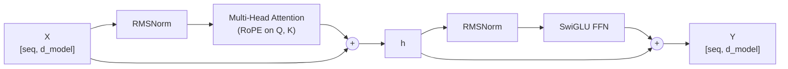
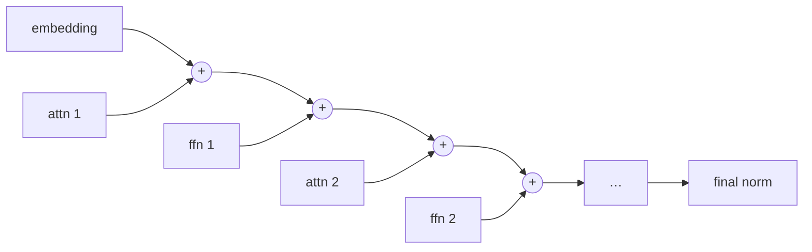
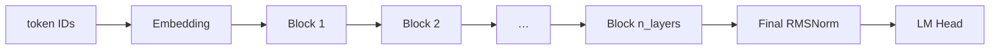

# Chapter 8 — Residuals & the Decoder Block

> Symbols such as `seq`, `ctx` and `d_model` are defined in [Chapter 0 — Notation](ch-0-overview.md#notation).

Chapters 3–7 described the parts. This chapter assembles them into one **decoder block**
and stacks `n_layers` blocks into the full network body.

## 1. One block



```
h = X + MHA(RMSNorm(X))      # tokens exchange information
Y = h + FFN(RMSNorm(h))      # each token is processed on its own
```

Input and output have the same shape, `[seq, d_model]`, so blocks can be stacked any number
of times.

## 2. The residual stream

The `+` connections are **residual** (skip) connections. Instead of replacing `x`, each
sub-layer computes an update and **adds** it:



A useful mental model: there is one shared vector per token — the **residual stream** — that
starts as the token embedding. Every attention and FFN layer reads a normalized copy of it and
writes an update back into it. Benefits:

- **Easy gradient flow**: the sum path gives every layer a direct route to the output, so very
  deep stacks (32–100+ layers) train reliably.
- **Incremental refinement**: each layer only has to learn a small change, not a whole new
  representation.

## 3. Stacking n_layers blocks



All blocks have the same structure but **separate weights**. Because the stack uses pre-norm
(Ch 4), the residual stream itself is never normalized inside the blocks, so a **final
RMSNorm** is applied after the last block (block `n_layers`), before the LM head (Ch 10).

## 4. Parameters (Llama-2-7B)

| Part | Formula | Params |
|------|---------|-------:|
| Attention (`W_Q, W_K, W_V, W_O`) | 4 · 4096² | 67,108,864 |
| FFN (`W_gate, W_up, W_down`) | 3 · 4096 · 11008 | 135,266,304 |
| 2 × RMSNorm `γ` | 2 · 4096 | 8,192 |
| **One block** | | **202,383,360** |
| **32 blocks** | × 32 | **6,476,267,520** (≈ 6.48B) |

The blocks are ≈ 96% of the model; the embedding and LM head make up the rest (Ch 12).
Within a block, the FFN is two thirds and attention one third.

## 5. Code

```python
def decoder_block(X, p):
    # p holds this block's weights; mha, ffn_swiglu, rms_norm from earlier chapters
    h = X + mha(rms_norm(X, p.g1), p.W_Q, p.W_K, p.W_V, p.W_O, p.n_heads, causal_attention)
    return h + ffn_swiglu(rms_norm(h, p.g2), p.W_gate, p.W_up, p.W_down)

def body(X, blocks, g_final):
    for p in blocks:
        X = decoder_block(X, p)
    return rms_norm(X, g_final)
```

## Key takeaways

- A block = (norm → attention → add) then (norm → FFN → add).
- Residual connections make each layer an additive update to a shared stream.
- `n_layers` identical-shaped blocks with separate weights, followed by a final norm.

## References

The most important sources for this chapter, in order of importance.

1. He, K., Zhang, X., Ren, S., Sun, J. (2016). *Deep Residual Learning for Image Recognition*. CVPR 2016. [arXiv:1512.03385](https://arxiv.org/abs/1512.03385) — residual connections.
2. He, K., Zhang, X., Ren, S., Sun, J. (2016). *Identity Mappings in Deep Residual Networks*. ECCV 2016. [arXiv:1603.05027](https://arxiv.org/abs/1603.05027) — identity skip paths and pre-activation.
3. Vaswani, A., Shazeer, N., Parmar, N., et al. (2017). *Attention Is All You Need*. NeurIPS 2017. [arXiv:1706.03762](https://arxiv.org/abs/1706.03762) — the Transformer block.
4. Xiong, R., Yang, Y., He, D., et al. (2020). *On Layer Normalization in the Transformer Architecture*. ICML 2020. [arXiv:2002.04745](https://arxiv.org/abs/2002.04745) — pre-norm and training stability.
5. Liu, L., Liu, X., Gao, J., Chen, W., Han, J. (2020). *Understanding the Difficulty of Training Transformers*. EMNLP 2020. [arXiv:2004.08249](https://arxiv.org/abs/2004.08249) — residual-branch dependence in deep Transformers.
6. Wang, Q., Li, B., Xiao, T., et al. (2019). *Learning Deep Transformer Models for Machine Translation*. ACL 2019. [arXiv:1906.01787](https://arxiv.org/abs/1906.01787) — stacking many pre-norm layers.
7. Veit, A., Wilber, M., Belongie, S. (2016). *Residual Networks Behave Like Ensembles of Relatively Shallow Networks*. NeurIPS 2016. [arXiv:1605.06431](https://arxiv.org/abs/1605.06431) — residual networks as ensembles.
8. Srivastava, R. K., Greff, K., Schmidhuber, J. (2015). *Training Very Deep Networks*. NeurIPS 2015. [arXiv:1507.06228](https://arxiv.org/abs/1507.06228) — gated skip connections (background).
9. Zhang, A., Lipton, Z. C., Li, M., Smola, A. J. (2023). *Dive into Deep Learning*. Cambridge University Press. https://d2l.ai/ — textbook: residual networks and Transformer blocks.
10. Goodfellow, I., Bengio, Y., Courville, A. (2016). *Deep Learning*. MIT Press. https://www.deeplearningbook.org/ — textbook: deep architectures.

---

← [Chapter 7 — Feed-Forward Network](ch-7-feed-forward-network.md) · [Chapter 9 — Mixture of Experts](ch-9-mixture-of-experts.md) →
