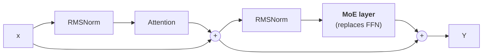
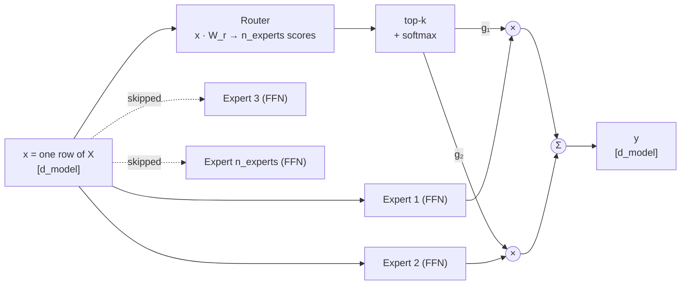

# Chapter 9 — Mixture of Experts (MoE)

> Symbols such as `seq`, `ctx` and `d_model` are defined in [Chapter 0 — Notation](ch-0-overview.md#notation).

Making a dense model bigger makes every token more expensive, because every token uses every
weight. A Mixture-of-Experts layer breaks that link: it holds many FFNs ("experts") but sends
each token through only a few of them. The model can store far more parameters while the
compute per token stays small.

## 1. Where it goes

MoE replaces the FFN in some or all decoder blocks. Attention is unchanged.



## 2. Inside the MoE layer

Like the FFN it replaces, the MoE layer takes `X : [seq, d_model]` and returns
`[seq, d_model]`, and each row (token) is handled **independently**. The router scores all
rows at once (`X · W_r : [seq, n_experts]`), but each row picks its own top-k experts. So different
tokens in the same sequence can go to different experts. The diagram follows **one row**
`x : [d_model]`:



```
scores = x · W_r                       W_r : [d_model, n_experts]
S      = indices of the top-k scores
g_i    = softmax(scores[S])_i          weights of the chosen experts, sum to 1
y      = Σ_{i ∈ S} g_i · Expert_i(x)
```

Each expert is an ordinary SwiGLU FFN (Ch 7). The router is a single small linear layer.
Routing is decided **per token, per layer**: neighbouring tokens may use different experts.

## 3. Worked example

`n_experts = 4`, `k = 2`. Router scores for one token: `[2.0, 1.0, 0.1, −1.0]`.

```
step 1  top-2           → experts 0 and 1 (scores 2.0, 1.0)
step 2  softmax([2, 1]) → g₀ = e²/(e²+e¹) ≈ 0.731,  g₁ ≈ 0.269
step 3  y = 0.731 · Expert₀(x) + 0.269 · Expert₁(x)
        experts 2 and 3 are not computed at all for this token
```

## 4. Total vs. active parameters

| Model | Experts | Active per token | Total params | Active params |
|-------|---------|------------------|-------------:|--------------:|
| Mixtral 8x7B | 8 | top-2 | ≈ 46.7B | ≈ 12.9B |
| DeepSeek-V3  | 256 routed + 1 shared | top-8 routed + shared | ≈ 671B | ≈ 37B |

- **Compute per token** scales with **active** params (≈ k experts), like a much smaller dense model.
- **Memory** scales with **total** params: all experts must be loaded, because any token may
  pick any expert.

Some designs (e.g. DeepSeek) add **shared experts** that every token always uses, alongside the
routed ones, to hold common knowledge.

## 5. Inference considerations

- **Load balance**: during training an auxiliary loss (or a bias adjustment) pushes the router
  to spread tokens evenly; otherwise a few experts get overloaded and others go unused.
- **Batching**: within a batch, different tokens go to different experts, so the work is
  regrouped by expert before the matrix multiplies, then scattered back.
- **Expert parallelism**: large MoE models put different experts on different GPUs, so tokens
  are sent between devices (all-to-all communication) in each MoE layer.
- **Decode**: at small batch sizes, only the chosen experts' weights are read, so per-token
  memory traffic is closer to the active size than the total size.

## 6. Code

```python
import numpy as np

def moe_token(x, W_r, experts, k=2):
    # x: [d_model] (one row); experts: list of callables (each a SwiGLU FFN)
    scores = x @ W_r                                   # [n_experts]
    top = np.argsort(scores)[-k:]                      # indices of top-k
    g = np.exp(scores[top] - scores[top].max())
    g = g / g.sum()                                    # softmax over chosen
    return sum(gi * experts[i](x) for gi, i in zip(g, top))

def moe(X, W_r, experts, k=2):
    # X: [seq, d_model] -> [seq, d_model]; each row routed independently
    return np.stack([moe_token(x, W_r, experts, k) for x in X])
```

## Key takeaways

- MoE = many FFN experts + a router that picks top-k per token.
- Compute follows active parameters; memory follows total parameters.
- It lets models grow capacity without a matching growth in per-token cost.

## References

The most important sources for this chapter, in order of importance.

1. Shazeer, N., Mirhoseini, A., Maziarz, K., et al. (2017). *Outrageously Large Neural Networks: The Sparsely-Gated Mixture-of-Experts Layer*. ICLR 2017. [arXiv:1701.06538](https://arxiv.org/abs/1701.06538) — sparsely-gated MoE with top-k routing.
2. Jacobs, R. A., Jordan, M. I., Nowlan, S. J., Hinton, G. E. (1991). *Adaptive Mixtures of Local Experts*. Neural Computation, 3(1), 79–87. — the original mixture of experts.
3. Jordan, M. I., Jacobs, R. A. (1994). *Hierarchical Mixtures of Experts and the EM Algorithm*. Neural Computation, 6(2), 181–214. — hierarchical mixtures of experts.
4. Lepikhin, D., Lee, H., Xu, Y., et al. (2021). *GShard: Scaling Giant Models with Conditional Computation and Automatic Sharding*. ICLR 2021. [arXiv:2006.16668](https://arxiv.org/abs/2006.16668) — MoE Transformers at scale, expert parallelism.
5. Fedus, W., Zoph, B., Shazeer, N. (2022). *Switch Transformers: Scaling to Trillion Parameter Models with Simple and Efficient Sparsity*. JMLR 23. [arXiv:2101.03961](https://arxiv.org/abs/2101.03961) — top-1 routing, load balancing.
6. Dai, D., Deng, C., Zhao, C., et al. (2024). *DeepSeekMoE: Towards Ultimate Expert Specialization in Mixture-of-Experts Language Models*. ACL 2024. [arXiv:2401.06066](https://arxiv.org/abs/2401.06066) — shared experts and fine-grained experts.
7. Du, N., Huang, Y., Dai, A. M., et al. (2022). *GLaM: Efficient Scaling of Language Models with Mixture-of-Experts*. ICML 2022. [arXiv:2112.06905](https://arxiv.org/abs/2112.06905) — total vs. active parameters in a large MoE LLM.
8. Zhou, Y., Lei, T., Liu, H., et al. (2022). *Mixture-of-Experts with Expert Choice Routing*. NeurIPS 2022. [arXiv:2202.09368](https://arxiv.org/abs/2202.09368) — alternative routing: experts choose tokens.
9. Rajbhandari, S., Li, C., Yao, Z., et al. (2022). *DeepSpeed-MoE: Advancing Mixture-of-Experts Inference and Training to Power Next-Generation AI Scale*. ICML 2022. [arXiv:2201.05596](https://arxiv.org/abs/2201.05596) — MoE inference systems.
10. Clark, A., de las Casas, D., Guy, A., et al. (2022). *Unified Scaling Laws for Routed Language Models*. ICML 2022. [arXiv:2202.01169](https://arxiv.org/abs/2202.01169) — scaling behaviour of routed models.

---

← [Chapter 8 — Residuals & the Decoder Block](ch-8-decoder-block.md) · [Chapter 10 — LM Head & Sampling](ch-10-lm-head-and-sampling.md) →
