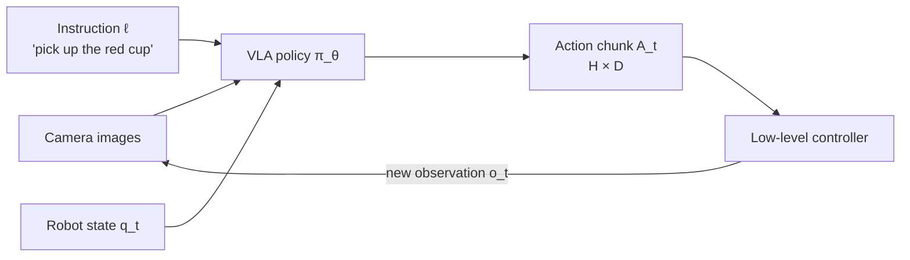

# Chapter 0 — Overview

A **Vision-Language-Action (VLA) model** maps what a robot **sees** (camera images), what it is **told** (a language instruction) and, often, what it **feels** (its own joint state) to **actions**: the motor commands that move the robot. Most VLAs start from a pretrained **Vision-Language Model (VLM)** and add a way to output actions.

This tutorial is about **inference**: what each component does, from the moment a camera frame arrives until a motor command is sent. Training is mentioned only where it explains an inference-time design choice.

## Big picture

Every VLA can be read as the same six-stage pipeline. Each chapter zooms into part of it.

```mermaid
flowchart LR
    subgraph IN[1 Inputs]
        direction LR
        I1[Images] ~~~ I2["Instruction ℓ"] ~~~ I3["State q_t"]
    end
    subgraph ENC[2 Encoders]
        direction LR
        E1[Vision encoder] ~~~ E2[Tokenizer] ~~~ E3[State projector]
    end
    subgraph BB[3 Backbone]
        direction LR
        P[Projector] --> LLM[LLM decoder<br/>+ KV cache]
    end
    subgraph AH[4 Action head]
        direction LR
        H1[Tokens / regression /<br/>diffusion / flow]
    end
    subgraph POST[5 Execution]
        direction LR
        D1[De-normalize,<br/>schedule chunk]
    end
    subgraph CT[6 Control]
        direction LR
        C1[Controller]
    end
    IN --> ENC --> BB --> AH --> POST --> CT
```

## Chapters

| # | Chapter | What you will learn |
|---|---|---|
| 0 | [Overview](ch-0-overview.md) | Big picture, chapter map, notation, running example |
| 1 | [The Inference Loop](ch-1-inference-loop.md) | Closed perception-action loop, the three rates, latency budget |
| 2 | [Inputs and Encoders](ch-2-inputs-and-encoders.md) | Vision encoders, image tokens, language tokens, proprioception |
| 3 | [The VLM Backbone](ch-3-vlm-backbone.md) | Projector, token layout, attention mask, KV cache |
| 4 | [Action Heads](ch-4-action-heads.md) | Discrete bins, FAST, regression, flow matching, chunking |
| 5 | [Action Execution](ch-5-action-execution.md) | De-normalization, chunk scheduling, ensembling, real-time chunking |
| 6 | [Dual-System Architectures](ch-6-dual-system-architectures.md) | Slow "System 2" VLM plus fast "System 1" policy |
| 7 | [Inference Optimization](ch-7-inference-optimization.md) | Memory, FLOPs, quantization, caching, deployment |
| 8 | [End-to-End Walkthrough](ch-8-end-to-end-walkthrough.md) | One inference step traced with shapes, model comparison |

## Essential vs. popular components

- **Essential**: needed by essentially every VLA.
- **Popular**: widely used in current models, but not required.

| Component | Kind | Examples | Chapter |
|---|---|---|---|
| Vision encoder | Essential | SigLIP, DINOv2, CLIP ViT | 2 |
| Tokenizer and text embeddings | Essential | Llama, Gemma tokenizers | 2 |
| Vision-to-language projector | Essential | Linear, 2-layer MLP | 3 |
| LLM / transformer backbone | Essential | Llama 2, Gemma, SmolLM2 | 3 |
| Action head | Essential | Bins, regression, diffusion, flow | 4 |
| Action normalization | Essential | Quantile bounds, mean/std | 4, 5 |
| Proprioceptive input | Popular | π0, Octo, GR00T N1, SmolVLA | 2 |
| Action chunking | Popular | ACT, π0, OpenVLA-OFT | 4, 5 |
| Flow / diffusion action expert | Popular | π0, GR00T N1, Octo, SmolVLA | 4 |
| Compressed action tokens | Popular | FAST | 4 |
| Asynchronous / real-time chunking | Popular | SmolVLA, RTC | 5 |
| Dual system | Popular | Helix, GR00T N1 | 6 |
| Quantization, fused kernels | Popular | int8 / int4, FlashAttention | 7 |

## Notation

All chapters use **only** these symbols, and each symbol has exactly one meaning. A tilde marks a **normalized** quantity (for example, `ã` is the normalized version of `a`). The last column gives the value in the **running example (RE)** defined below.

### Time and rates

| Symbol | Meaning | RE value |
|---|---|---|
| `t` | Control timestep index | — |
| `f_a` | Action rate: actions sent to the robot per second (Hz) | 50 Hz |
| `f_inf` | Inference rate: VLA calls per second (Hz) | 2 Hz |
| `f_c` | Low-level controller rate (Hz) | ≥ 500 Hz |
| `T_inf` | Latency of one VLA inference (s) | 0.073 s |
| `s` | Actions that execute during one inference, `s = ⌈T_inf · f_a⌉` | 4 |
| `f_S1`, `f_S2` | Rates of System 1 / System 2 in a dual-system model (Hz) | 200 Hz / 8 Hz |

### Inputs and tokens

| Symbol | Meaning | RE value |
|---|---|---|
| `ℓ` | Language instruction | "pick up the red cup" |
| `o_t` | Observation at time `t` (images and state) | — |
| `C` | Number of cameras | 3 |
| `R` | Image side length after resizing (pixels, square images) | 224 |
| `P` | Patch side length (pixels) | 14 |
| `N_p` | Patches (tokens) per image, `N_p = (R/P)²` | 256 |
| `N_img` | Image tokens over all cameras, `N_img = C · N_p` | 768 |
| `N_txt` | Text tokens of the prompt (assumed) | 8 |
| `N_pre` | Prefix tokens, `N_pre = N_img + N_txt` | 776 |
| `N_suf` | Suffix tokens (state + actions), `N_suf = 1 + H` | 51 |
| `q_t` | Proprioceptive state vector at time `t` | — |
| `D_q` | Dimension of `q_t` | 8 |

### Model

| Symbol | Meaning | RE value |
|---|---|---|
| `θ` | Model parameters | — |
| `N_θ` | Parameter count of the network being discussed | VLM 2×10⁹, expert 3×10⁸ |
| `π_θ` | The policy (the VLA) | — |
| `d_v` | Vision-encoder output width | 1152 |
| `d` | LLM hidden width | 2048 |
| `d_e` | Action-expert hidden width | 1024 |
| `L` | Number of transformer layers | 18 |
| `n_h` | Attention query heads per layer | 8 |
| `n_kv` | Key/value heads per layer | 1 |
| `d_h` | Width of one attention head | 256 |
| `h_v` | One vision-encoder output vector, in `ℝ^{d_v}` | — |
| `h` | One token vector inside the LLM, in `ℝ^{d}` | — |
| `h_e` | One token vector inside the action expert, in `ℝ^{d_e}` | — |
| `W_proj` | Projector weight matrix, `d_v × d` | — |
| `W_q` | State-projection weight matrix, `D_q × d_e` | — |
| `Q`, `K`, `V` | Attention query, key and value matrices | — |
| `M` | Attention mask matrix (entries 0 or −∞) | — |
| `β` | Bytes per stored number | 2 (bf16) |
| `F` | Floating-point operations (FLOPs) of one forward pass | — |
| `BW` | GPU memory bandwidth (bytes/s) | 1×10¹² |

### Actions

| Symbol | Meaning | RE value |
|---|---|---|
| `D` | Action dimension | 7 |
| `a_t` | Action at time `t`, in `ℝ^D` | — |
| `A_t` | Action chunk `[a_t, …, a_{t+H−1}]`, in `ℝ^{H×D}` | — |
| `H` | Chunk length (actions per inference) | 50 |
| `n` | Actions executed before replanning | 25 |
| `a_lo`, `a_hi` | Per-dimension 1st / 99th percentile of training actions | — |
| `μ`, `σ` | Per-dimension mean / standard deviation of training actions | — |
| `B` | Number of action bins | 256 |
| `Δ` | Bin width in normalized space, `Δ = 2/B` | 0.0078125 |
| `b` | Bin index, `0 … B−1` | — |
| `γ` | FAST scale factor applied before rounding | 10 |
| `Z` | Rounded DCT coefficients of a chunk (FAST) | — |
| `a_t^{(i)}` | The `i`-th overlapping prediction of `a_t` (temporal ensembling) | — |
| `w_i` | Weight of prediction `i` in temporal ensembling | — |
| `m` | Temporal-ensembling decay rate | — |
| `z` | Latent vector sent from System 2 to System 1 | — |

### Flow matching

| Symbol | Meaning | RE value |
|---|---|---|
| `τ` | Flow time in `[0, 1]`: 0 = pure noise, 1 = clean actions | — |
| `A_t^τ` | Chunk at flow time `τ` | — |
| `ε` | Gaussian noise, `ε ~ 𝒩(0, I)` | — |
| `𝒩(0, I)` | Standard normal distribution (`I` = identity matrix) | — |
| `u` | Target velocity used in training, `u = A_t − ε` | — |
| `v_θ` | Learned velocity field (network output) | — |
| `S` | Number of integration (denoising) steps | 10 |
| `δ` | Integration step size, `δ = 1/S` | 0.1 |
| `i`, `j` | Generic indices | — |

## Running example

Every chapter computes its numbers on the same robot and model:

- **Robot**: one 7-DoF arm with a gripper. Action `a_t` (`D = 7`) = 3 position changes, 3 rotation changes, 1 gripper command. State `q_t` (`D_q = 8`) = 7 joint angles + gripper opening.
- **Cameras**: `C = 3` (one base camera, one wrist camera, one side camera), resized to `R = 224`.
- **Instruction**: `ℓ` = "pick up the red cup", assumed to be `N_txt = 8` tokens.
- **Model**: π0-style. SigLIP So400m/14 vision encoder (`d_v = 1152`), Gemma-2B-size LLM (`d = 2048`, `L = 18`, `n_h = 8`, `n_kv = 1`, `d_h = 256`) and a flow-matching action expert (`d_e = 1024`, about 3×10⁸ parameters). It outputs chunks of `H = 50` with `S = 10` integration steps.
- **Execution**: `f_a = 50 Hz`, replanning every `n = 25` actions. The latency is `T_inf = 0.073 s`, the on-board figure reported for π0 on an RTX 4090.

Some chapters also compare against **OpenVLA** (≈7.5×10⁹ parameters, autoregressive 256-bin tokens, one action per inference).

## Reference models

| Model | Year | Backbone | Action head |
|---|---|---|---|
| RT-2 | 2023 | PaLI-X / PaLM-E | Discrete tokens, 256 bins |
| Octo | 2024 | Transformer from scratch | Diffusion head |
| OpenVLA | 2024 | Llama 2 7B + DINOv2 + SigLIP | Discrete tokens, 256 bins |
| π0 | 2024 | PaliGemma (Gemma 2B + SigLIP) | Flow-matching action expert |
| π0-FAST | 2025 | PaliGemma | FAST compressed tokens |
| OpenVLA-OFT | 2025 | OpenVLA | Parallel decoding, continuous chunks |
| GR00T N1 | 2025 | Eagle-2 VLM | Flow-matching diffusion transformer |
| Helix | 2025 | 7B VLM (System 2) | 80M fast policy (System 1) |
| π0.5 | 2025 | PaliGemma-based | Subtask text + flow-matching expert |
| SmolVLA | 2025 | SmolVLM2 | Flow-matching action expert |

## Key takeaways

- A VLA is a VLM plus an action-producing component, running inside a closed control loop.
- The pipeline has six stages: inputs → encoders → backbone → action head → execution → control.
- Use the Notation table as the single source of symbols. The running example is the single source of numbers.

## References

1. A. Brohan et al., "RT-2: Vision-Language-Action Models Transfer Web Knowledge to Robotic Control," *CoRL*, 2023.
2. M. J. Kim et al., "OpenVLA: An Open-Source Vision-Language-Action Model," *CoRL*, 2024.
3. K. Black et al., "π0: A Vision-Language-Action Flow Model for General Robot Control," *RSS*, 2025.
4. K. Pertsch et al., "FAST: Efficient Action Tokenization for Vision-Language-Action Models," *RSS*, 2025.
5. M. J. Kim, C. Finn, P. Liang, "Fine-Tuning Vision-Language-Action Models: Optimizing Speed and Success," *RSS*, 2025.
6. T. Z. Zhao et al., "Learning Fine-Grained Bimanual Manipulation with Low-Cost Hardware" (ACT), *RSS*, 2023.
7. K. Black et al. (Physical Intelligence), "π0.5: a Vision-Language-Action Model with Open-World Generalization," *CoRL*, PMLR 305, 2025.
8. NVIDIA Technical Blog, "Accelerate Generalist Humanoid Robot Development with NVIDIA Isaac GR00T N1," Mar. 2025. https://developer.nvidia.com/blog/accelerate-generalist-humanoid-robot-development-with-nvidia-isaac-gr00t-n1
9. Figure AI, "Helix: A Vision-Language-Action Model for Generalist Humanoid Control," company blog, Feb. 2025. https://figure.ai/news/helix
10. Hugging Face Blog, "SmolVLA: Efficient Vision-Language-Action Model trained on Lerobot Community Data," Jun. 2025. https://huggingface.co/blog/smolvla

---

Next → [Chapter 1 — The Inference Loop](ch-1-inference-loop.md)
