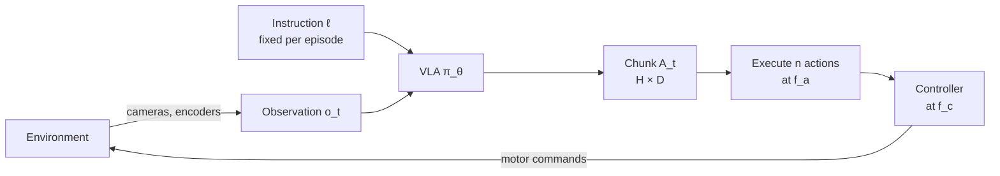
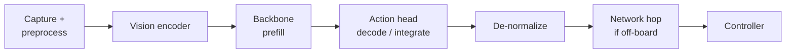

# Chapter 1 — The Inference Loop

A VLA is not called once. It runs **inside a closed loop**: observe, infer, act, observe again. The timing of this loop shapes every design decision in later chapters. This chapter defines the three rates involved and shows where the latency comes from.

## Diagrams

### The perception-action loop



At each inference:

1. **Sense**: read `C` camera images and the state `q_t`.
2. **Infer**: run `π_θ(o_t, ℓ)` and get a chunk `A_t` of `H` actions.
3. **Act**: send `n ≤ H` of those actions at rate `f_a`.
4. **Repeat** with a new observation.

### Where one inference spends its time



## Formulas

The three rates are different numbers. Do not mix them up:

| Rate | Meaning | Typical range |
|---|---|---|
| `f_inf` | VLA calls per second | 1–10 Hz |
| `f_a` | Actions sent per second | 5–50 Hz (200 Hz in Helix System 1) |
| `f_c` | Controller updates per second | 500 Hz and up |

If the robot executes `n` actions per chunk, then in steady state:

```text
f_inf = f_a / n                    (inferences per second)
chunk duration = H / f_a           (seconds of motion one chunk covers)
s = ⌈T_inf · f_a⌉                  (actions that pass while the model thinks)
```

For **synchronous** execution (the robot waits during inference), the fraction of time the robot is idle is:

```text
idle fraction = T_inf / (T_inf + n / f_a)
```

## Running example

With `f_a = 50 Hz`, `H = 50`, `n = 25`, `T_inf = 0.073 s`:

| Quantity | Computation | Value |
|---|---|---|
| Inference rate `f_inf` | 50 / 25 | 2 Hz |
| Chunk duration | 50 / 50 | 1.0 s |
| Time to execute `n` actions | 25 / 50 | 0.5 s |
| Actions passing during inference `s` | ⌈0.073 · 50⌉ = ⌈3.65⌉ | 4 |
| Synchronous idle fraction | 0.073 / (0.073 + 0.5) | 12.7 % |

π0's paper reports this latency breakdown for 3 cameras on an RTX 4090:

| Stage | Time |
|---|---|
| Image encoders | 14 ms |
| Observation (prefix) forward pass | 32 ms |
| 10 action-expert passes | 27 ms |
| **Total on-board** | **73 ms** |
| Network (off-board inference) | 13 ms |
| **Total off-board** | **86 ms** |

The backbone forward pass is the largest single item. Chapter 7 shows how to estimate it from first principles.

## Worked example

A small robot uses `f_a = 10 Hz`, `H = 4`, `n = 2`, and `T_inf = 0.15 s`.

- `f_inf = 10 / 2 = 5 Hz`
- Chunk duration `= 4 / 10 = 0.4 s`
- `s = ⌈0.15 · 10⌉ = ⌈1.5⌉ = 2`: two actions' worth of time passes during each inference.
- Synchronous idle fraction `= 0.15 / (0.15 + 2/10) = 0.15 / 0.35 ≈ 42.9 %`

The robot would be idle almost half the time. This is why the asynchronous execution in Chapter 5 matters.

## NumPy snippet

```python
import numpy as np

f_a, H, n, T_inf = 50, 50, 25, 0.073
f_inf = f_a / n                          # 2.0 Hz
chunk_s = H / f_a                        # 1.0 s
s = int(np.ceil(T_inf * f_a))            # 4
idle = T_inf / (T_inf + n / f_a)         # 0.1274
print(f_inf, chunk_s, s, round(idle, 4))
```

## Key takeaways

- A VLA runs in a closed loop. Its own actions change its next observation.
- `f_inf`, `f_a` and `f_c` are different rates. Chunking lets `f_a` exceed `f_inf`.
- In the running example, one inference (73 ms) covers 4 action steps, and one chunk covers 1 s of motion.
- Synchronous execution wastes time, and the waste grows as `T_inf` approaches `n / f_a`.

## References

1. K. Black et al., "π0: A Vision-Language-Action Flow Model for General Robot Control," *RSS*, 2025.
2. M. J. Kim et al., "OpenVLA: An Open-Source Vision-Language-Action Model," *CoRL*, 2024.
3. T. Z. Zhao et al., "Learning Fine-Grained Bimanual Manipulation with Low-Cost Hardware" (ACT), *RSS*, 2023.
4. K. Black, M. Y. Galliker, S. Levine, "Real-Time Execution of Action Chunking Flow Policies," *NeurIPS*, 2025.
5. S. Ross, G. Gordon, D. Bagnell, "A Reduction of Imitation Learning and Structured Prediction to No-Regret Online Learning" (DAgger), *AISTATS*, 2011.
6. K. M. Lynch, F. C. Park, *Modern Robotics: Mechanics, Planning, and Control*, Cambridge University Press, 2017. (Textbook.)
7. B. Siciliano, L. Sciavicco, L. Villani, G. Oriolo, *Robotics: Modelling, Planning and Control*, Springer, 2009. (Textbook.)
8. Figure AI, "Helix: A Vision-Language-Action Model for Generalist Humanoid Control," company blog, Feb. 2025. https://figure.ai/news/helix

---

← Previous: [Chapter 0 — Overview](ch-0-overview.md) | Next → [Chapter 2 — Inputs and Encoders](ch-2-inputs-and-encoders.md)
