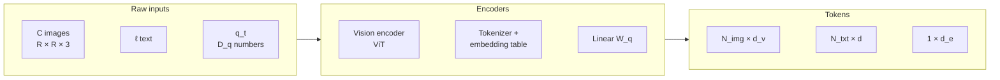
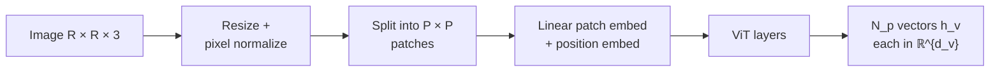
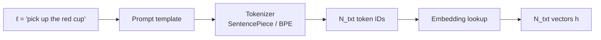
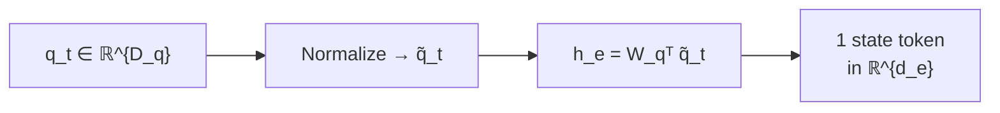

# Chapter 2 — Inputs and Encoders

A transformer only processes vectors. This chapter shows how the three raw inputs (images, the instruction `ℓ`, and the state `q_t`) become **tokens**. In the running example, image tokens make up almost the whole input sequence, so they drive the cost of everything that follows.

## Diagrams

### Overview



### Vision encoder (essential)



| Encoder | Pretraining | Strength | Used by |
|---|---|---|---|
| SigLIP | Image-text, sigmoid loss | Semantics aligned with language | π0, OpenVLA, SmolVLA |
| DINOv2 | Self-supervised | Spatial and geometric detail | OpenVLA (fused with SigLIP) |
| CLIP ViT | Image-text, contrastive | Semantics | Early VLMs |

OpenVLA runs SigLIP and DINOv2 on the same image and **concatenates their per-patch features** (1152 + 1024 = 2176 channels): SigLIP for *what*, DINOv2 for *where*.

Preprocessing at inference (resize method, crop, pixel normalization) must match training exactly. A mismatch fails silently.

### Language (essential)



The instruction uses the backbone LLM's own tokenizer. Many models wrap it in a fixed template. OpenVLA, for example, uses `In: What action should the robot take to {ℓ}?\nOut:`. Because `ℓ` usually stays fixed for a whole episode, its tokens can be prepared once.

### Proprioception (popular)



- **RT-2 and OpenVLA** use images only. They have no state input.
- **Octo, π0, GR00T N1 and SmolVLA** feed `q_t`. In π0 the state token goes to the action expert, so its width is `d_e`.
- Cross-embodiment models often **zero-pad** `q_t` to a shared maximum size, so robots with different joint counts can share one network.

### Reducing image tokens (popular)

- **Token merging / pixel shuffle**: combine neighboring patches (SmolVLM-based models).
- **Learned readout / resampler**: a few learned queries summarize all patches.
- **Fewer cameras or a lower `R`** at inference.

## Formulas

```text
N_p   = (R / P)²                     patches per image
N_img = C · N_p                      image tokens
N_pre = N_img + N_txt                prefix tokens sent to the LLM
h_e   = W_qᵀ q̃_t,   W_q ∈ ℝ^{D_q × d_e}   state token
```

The ViT output for one image is a matrix of `N_p` rows, each an `h_v` vector:

```text
          ┌─ d_v = 1152 ─┐
patch 1   [ h_v ......... ]
patch 2   [ h_v ......... ]
  ...
patch 256 [ h_v ......... ]
```

## Running example

| Quantity | Computation | Value |
|---|---|---|
| Patches per side | 224 / 14 | 16 |
| `N_p` | 16² | 256 |
| `N_img` | 3 · 256 | 768 |
| `N_txt` | assumed | 8 |
| `N_pre` | 768 + 8 | 776 |
| Vision output per image | `N_p × d_v` | 256 × 1152 |
| Vision output, all cameras | `N_img × d_v` | 768 × 1152 |
| `W_q` shape | `D_q × d_e` | 8 × 1024 |

Image tokens are 768 / 776 ≈ 99 % of the prefix. Removing one camera would cut `N_pre` to 520.

## Worked example

A toy image with `R = 28` and `P = 14`:

```text
   ┌────14────┬────14────┐
   │ patch 1  │ patch 2  │ 14
   ├──────────┼──────────┤
   │ patch 3  │ patch 4  │ 14
   └──────────┴──────────┘
```

`N_p = (28/14)² = 2² = 4` tokens. With `C = 2` cameras, `N_img = 2 · 4 = 8`. Add `N_txt = 3` text tokens and `N_pre = 11`.

## NumPy snippet

```python
import numpy as np

def patchify(img, P):
    """img: R x R x 3 -> N_p x (P*P*3) flattened patches"""
    R = img.shape[0]
    g = R // P
    x = img.reshape(g, P, g, P, 3).transpose(0, 2, 1, 3, 4)
    return x.reshape(g * g, P * P * 3)

img = np.zeros((224, 224, 3), dtype=np.float32)
patches = patchify(img, 14)
print(patches.shape)          # (256, 588)
print(3 * patches.shape[0] + 8)  # N_pre = 776
```

## Key takeaways

- A ViT turns each `R × R` image into `N_p = (R/P)²` tokens. In the running example that is 256 per camera and 768 in total.
- Image tokens dominate the prefix (≈ 99 %), so they dominate the backbone's cost.
- SigLIP gives semantics and DINOv2 gives spatial detail. Some models fuse both.
- Language uses the LLM's own tokenizer and a fixed template. State uses one small linear layer `W_q`.
- Preprocessing at inference must match training exactly.

## References

1. A. Dosovitskiy et al., "An Image is Worth 16x16 Words: Transformers for Image Recognition at Scale," *ICLR*, 2021.
2. X. Zhai et al., "Sigmoid Loss for Language Image Pre-Training" (SigLIP), *ICCV*, 2023.
3. M. Oquab et al., "DINOv2: Learning Robust Visual Features without Supervision," *Transactions on Machine Learning Research (TMLR)*, 2024.
4. T. Kudo, J. Richardson, "SentencePiece: A simple and language independent subword tokenizer and detokenizer for Neural Text Processing," *EMNLP* (System Demonstrations), 2018.
5. R. Sennrich, B. Haddow, A. Birch, "Neural Machine Translation of Rare Words with Subword Units" (BPE), *ACL*, 2016.
6. S. Karamcheti et al., "Prismatic VLMs: Investigating the Design Space of Visually-Conditioned Language Models," *ICML*, 2024.
7. M. J. Kim et al., "OpenVLA: An Open-Source Vision-Language-Action Model," *CoRL*, 2024.
8. K. Black et al., "π0: A Vision-Language-Action Flow Model for General Robot Control," *RSS*, 2025.
9. Hugging Face Blog, "SmolVLA: Efficient Vision-Language-Action Model trained on Lerobot Community Data," Jun. 2025. https://huggingface.co/blog/smolvla
10. NVIDIA Technical Blog, "Accelerate Generalist Humanoid Robot Development with NVIDIA Isaac GR00T N1," Mar. 2025. https://developer.nvidia.com/blog/accelerate-generalist-humanoid-robot-development-with-nvidia-isaac-gr00t-n1

---

← Previous: [Chapter 1 — The Inference Loop](ch-1-inference-loop.md) | Next → [Chapter 3 — The VLM Backbone](ch-3-vlm-backbone.md)
