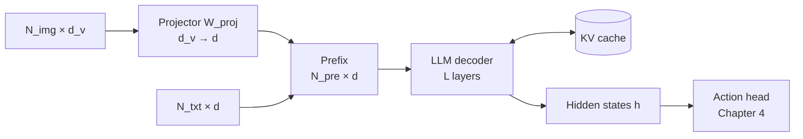
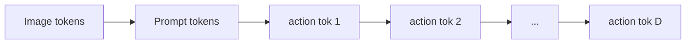
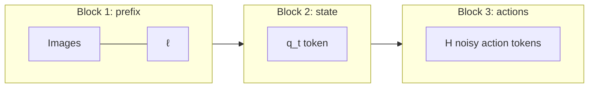
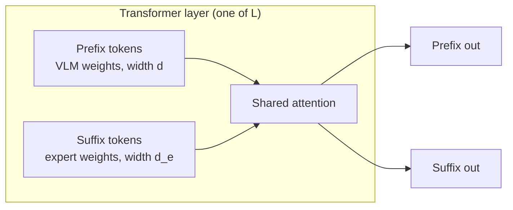
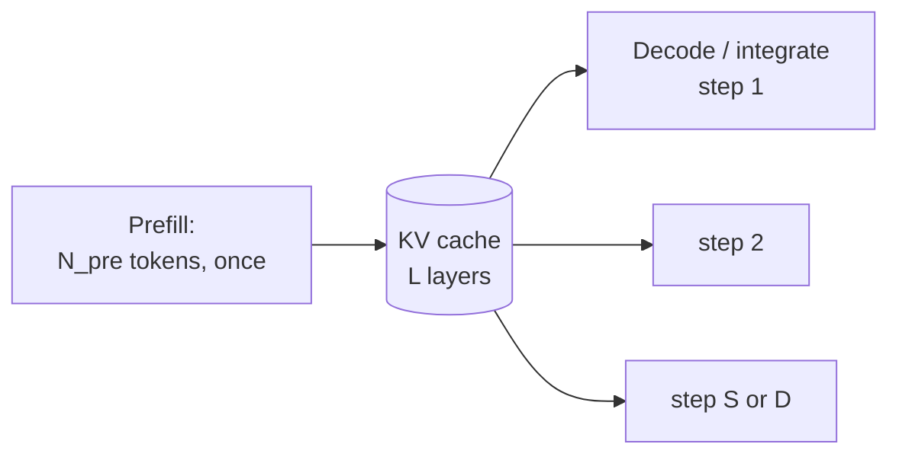

# Chapter 3 — The VLM Backbone

The backbone is a pretrained LLM decoder that **fuses** image, text and state tokens through self-attention. Its web-scale knowledge is the main reason VLAs generalize to new objects and instructions. This chapter covers the projector, how tokens are laid out and masked, and the KV cache, which makes repeated action decoding cheap.

## Diagrams

### Backbone data flow



### Projector (essential)

| Type | Description | Example |
|---|---|---|
| Linear | One matrix `W_proj` | PaliGemma, π0 |
| 2-layer MLP | Linear → GELU → Linear | OpenVLA (Prismatic), LLaVA |
| Resampler | Learned queries cross-attend to patches, output fewer tokens | Some VLMs |

### LLM decoder (essential)

| Model | LLM | Notes |
|---|---|---|
| OpenVLA | Llama 2 7B | Full model |
| π0 | Gemma 2B (inside PaliGemma) | Plus a ~3×10⁸-parameter action expert |
| GR00T N1 | Eagle-2 VLM | Uses features from a **middle** LLM layer |
| SmolVLA | SmolVLM2 | **Skips** the upper layers to save compute |

### Token layout A — fully causal (autoregressive VLAs)

Used by RT-2, OpenVLA and π0-FAST. Action tokens are generated after the prompt, one at a time.



### Token layout B — block-wise causal (π0-style)

The sequence has three blocks. Each block attends bidirectionally within itself and to **earlier** blocks, never to later ones.



Block 1 never sees Blocks 2 or 3, so **its keys and values do not change** while the actions are refined. It is computed once and cached.

### Two weight sets, one attention (π0 action expert)



In π0, prefix tokens use the large VLM weights and suffix tokens use the smaller action-expert weights. Both feed the **same** attention operation in every layer, so action tokens read VLM features layer by layer. GR00T N1 couples the two more loosely: a separate action transformer **cross-attends** to VLM features.

### KV cache: prefill once, decode many times



| Phase | Work | Bottleneck |
|---|---|---|
| Prefill | All `N_pre` tokens in parallel | Compute (FLOPs) |
| Decode | One token (layout A) or the suffix block (layout B) per step | Memory bandwidth |

## Formulas

Projector, applied to each vision vector:

```text
h = W_projᵀ h_v,     W_proj ∈ ℝ^{d_v × d}
```

Masked attention in one head:

```text
Attention(Q, K, V) = softmax( Q Kᵀ / √d_h + M ) V
M[i, j] = 0    if token i may attend to token j
M[i, j] = −∞   otherwise
```

KV cache size for the prefix (keys and values, all layers):

```text
KV bytes = 2 · L · N_pre · n_kv · d_h · β
```

Gemma 2B uses multi-query attention (`n_kv = 1`), which shrinks the cache by `n_h / n_kv = 8×` compared with full multi-head attention.

## Running example

| Quantity | Computation | Value |
|---|---|---|
| Projector input | `N_img × d_v` | 768 × 1152 |
| Projector output | `N_img × d` | 768 × 2048 |
| `W_proj` weights | 1152 · 2048 | 2,359,296 |
| Prefix into LLM | `N_pre × d` | 776 × 2048 |
| KV cache | 2 · 18 · 776 · 1 · 256 · 2 B | 14,303,232 B ≈ 14.3 MB |
| Suffix tokens `N_suf` | 1 + 50 | 51 |

Without caching, each of the `S = 10` integration steps would re-run the 776-token prefix through the 2B-parameter LLM. With caching, it runs once.

## Worked example

Two prefix tokens `p1, p2`, one state token `q`, one action token `a`. Layout B gives this mask `M` (rows = queries, columns = keys):

```text
          p1    p2    q     a
   p1  [  0     0    −∞    −∞ ]
   p2  [  0     0    −∞    −∞ ]
   q   [  0     0     0    −∞ ]
   a   [  0     0     0     0 ]
```

- The rows `p1` and `p2` block `q` and `a`. That is why the prefix cache stays valid.
- The row `a` sees everything, so the action token reads both image/text and state.

Tiny KV cache: `L = 2`, `N_pre = 3`, `n_kv = 1`, `d_h = 4`, `β = 2` gives `2 · 2 · 3 · 1 · 4 · 2 = 96` bytes.

## NumPy snippet

```python
import numpy as np

def block_causal_mask(block_sizes):
    ids = np.repeat(np.arange(len(block_sizes)), block_sizes)
    allowed = ids[:, None] >= ids[None, :]   # attend to same or earlier block
    return np.where(allowed, 0.0, -np.inf)

print(block_causal_mask([2, 1, 1]))          # matches the 4x4 mask above

L, N_pre, n_kv, d_h, beta = 18, 776, 1, 256, 2
print(2 * L * N_pre * n_kv * d_h * beta)     # 14303232 bytes
```

## Key takeaways

- The projector `W_proj` maps vision vectors into the LLM's width `d`. It is small (≈ 2.4 M weights in the running example) but essential.
- The mask decides what can be cached. Block-wise causal masks keep the prefix fixed, so it is computed once.
- Inference has two phases: an expensive prefill once, then cheap decode or integration steps that read the KV cache.
- In the running example, the prefix cache is ≈ 14.3 MB, kept small by multi-query attention.

## References

1. A. Vaswani et al., "Attention Is All You Need," *NeurIPS*, 2017.
2. J. Ainslie et al., "GQA: Training Generalized Multi-Query Transformer Models from Multi-Head Checkpoints," *EMNLP*, 2023. (Covers multi-query attention.)
3. R. Pope et al., "Efficiently Scaling Transformer Inference," *MLSys*, 2023.
4. S. Karamcheti et al., "Prismatic VLMs: Investigating the Design Space of Visually-Conditioned Language Models," *ICML*, 2024.
5. A. Brohan et al., "RT-2: Vision-Language-Action Models Transfer Web Knowledge to Robotic Control," *CoRL*, 2023.
6. M. J. Kim et al., "OpenVLA: An Open-Source Vision-Language-Action Model," *CoRL*, 2024.
7. K. Black et al., "π0: A Vision-Language-Action Flow Model for General Robot Control," *RSS*, 2025.
8. Google Developers Blog, "Introducing PaliGemma, Gemma 2, and an Upgraded Responsible AI Toolkit," May 2024. https://developers.googleblog.com/gemma-family-and-toolkit-expansion-io-2024/
9. NVIDIA Technical Blog, "Accelerate Generalist Humanoid Robot Development with NVIDIA Isaac GR00T N1," Mar. 2025. https://developer.nvidia.com/blog/accelerate-generalist-humanoid-robot-development-with-nvidia-isaac-gr00t-n1
10. Hugging Face Blog, "SmolVLA: Efficient Vision-Language-Action Model trained on Lerobot Community Data," Jun. 2025. https://huggingface.co/blog/smolvla

Note: The Gemma 2B configuration and Llama 2 are described only in arXiv technical reports (neither peer-reviewed nor a company blog), so they are not listed above. Their use in VLAs is covered by references 6 and 7.

---

← Previous: [Chapter 2 — Inputs and Encoders](ch-2-inputs-and-encoders.md) | Next → [Chapter 4 — Action Heads](ch-4-action-heads.md)
