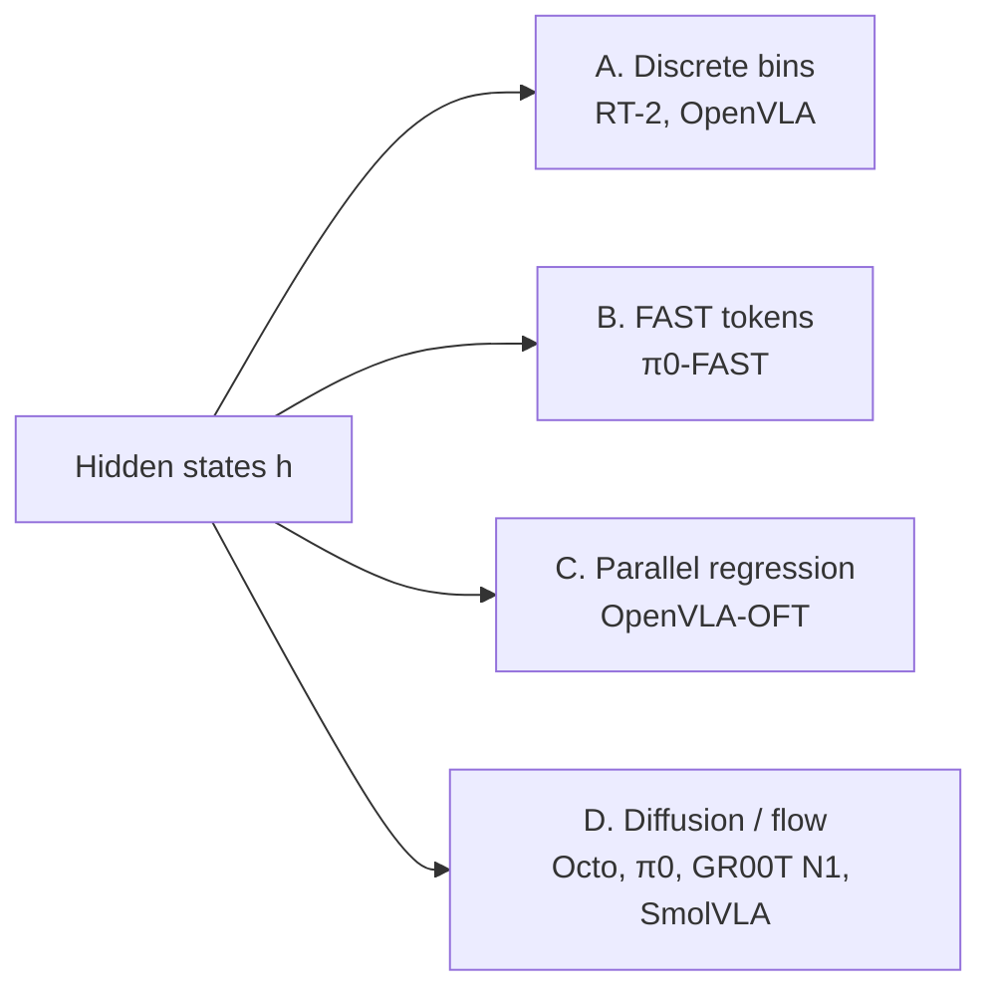
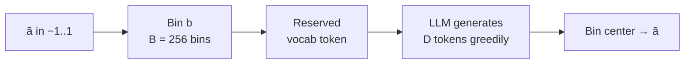
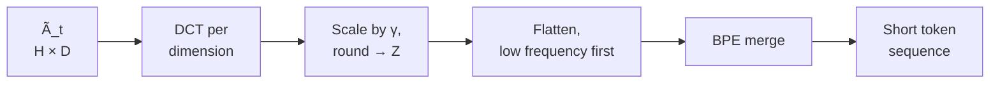
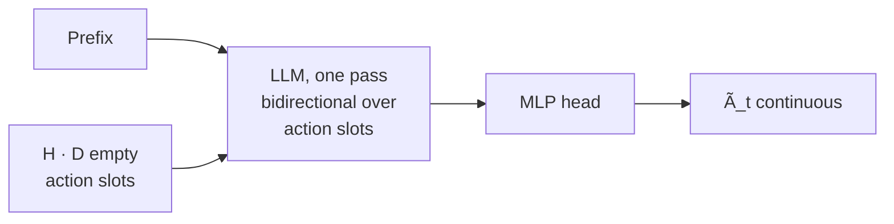
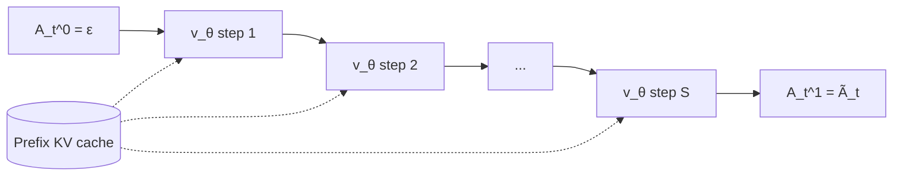
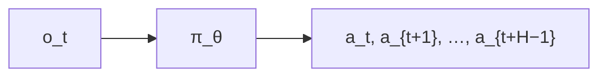

# Chapter 4 — Action Heads

The action head turns backbone hidden states into numbers a robot can execute. VLAs differ most here, and this choice largely decides **how many sequential network passes** one inference costs. This chapter covers the four families of heads, action normalization, and action chunking.

## Diagrams

### What an action is

In the running example, `a_t ∈ ℝ^7`: 3 position changes, 3 rotation changes, and 1 gripper command. Heads work on the **normalized** `ã_t`, which lies in `[−1, 1]` per dimension. The chunk `A_t` stacks `H` actions:

```text
          ┌────────────── D = 7 ──────────────┐
          position (3)   rotation (3)   grip
a_t       [ .   .   .  |  .   .   .  |   .  ]
a_{t+1}   [ .   .   .  |  .   .   .  |   .  ]      A_t ∈ ℝ^{H × D}
  ...                                              H = 50 rows
a_{t+49}  [ .   .   .  |  .   .   .  |   .  ]
```

### The four families



| Family | Decoding | Sequential passes per chunk | Strength | Weakness |
|---|---|---|---|---|
| A. Bins | Autoregressive | `H · D` LLM steps | Reuses the LLM head | Slow, coarse |
| B. FAST | Autoregressive over compressed tokens | Far fewer than `H · D` | LLM-native, handles high `f_a` | Still autoregressive |
| C. Regression | One parallel pass | 1 | Fastest | Averages multimodal behavior |
| D. Flow / diffusion | Iterative integration | `S` expert passes | Smooth, multimodal | `S` passes per inference |

### A. Discrete bins



OpenVLA reuses the 256 least-used Llama tokens as action tokens. Each action needs `D = 7` decode steps.

### B. FAST (DCT + BPE)



Smooth trajectories keep most of their energy in a few low-frequency coefficients. Most of `Z` is zero, and BPE compresses it further. At inference the pipeline runs in reverse: tokens → BPE decode → `Z / γ` → inverse DCT → `Ã_t`.

### C. Parallel regression (OpenVLA-OFT)



Trained with an L1 loss. The authors report throughput gains on the order of 25–50× over the original OpenVLA. The catch: regression predicts the **average** of valid behaviors. If "pass left" and "pass right" are both valid, the average drives into the obstacle.

### D. Flow matching (π0, GR00T N1, SmolVLA)



Only the small action expert runs `S` times. The large VLM ran once (Chapter 3). Diffusion heads (Octo, Diffusion Policy) work the same way with a noise-prediction sampler. Flow matching learns near-straight paths, so few steps are needed (π0: `S = 10`, GR00T N1: `S = 4`).

### Action chunking (popular, now near-universal)



Chunking (popularized by ACT) gives a higher `f_a` for the same `f_inf`, smoother motion within a chunk, and fewer decision points that compound errors. The cost is that the robot runs open-loop within a chunk. Chapter 5 handles this.

## Formulas

**Normalization** (essential, per dimension; statistics ship with the checkpoint):

```text
quantile:   ã = 2 · (a − a_lo) / (a_hi − a_lo) − 1,  then clip to [−1, 1]
mean/std:   ã = (a − μ) / σ
```

**Bins** (family A):

```text
Δ = 2 / B
b = min( ⌊(ã + 1) / Δ⌋ , B − 1 )
bin center = −1 + (b + ½) · Δ          maximum error = Δ / 2
```

**FAST** (family B), per action dimension (column of `Ã_t`):

```text
Z = round( γ · DCT(Ã_t) )             Ã_t ≈ IDCT( Z / γ )
```

**Flow matching** (family D):

```text
A_t^τ = τ · Ã_t + (1 − τ) · ε          interpolation path, ε ~ 𝒩(0, I)
u     = Ã_t − ε                         target velocity (training)
A_t^{τ+δ} = A_t^τ + δ · v_θ(A_t^τ, o_t, ℓ, τ),   δ = 1/S   (inference, Euler)
```

## Running example

| Quantity | Computation | Value |
|---|---|---|
| Numbers per chunk | `H · D` = 50 · 7 | 350 |
| Family A: sequential LLM steps for one chunk | `H · D` | 350 |
| Family A: steps for one action (OpenVLA) | `D` | 7 |
| Family C: passes for one chunk | — | 1 |
| Family D: expert passes for one chunk | `S` | 10 |
| Flow step size `δ` | 1 / 10 | 0.1 |
| Bin width `Δ` | 2 / 256 | 0.0078125 |
| Max binning error | `Δ / 2` | 0.00390625 |

## Worked example

**Binning** (`B = 256`), with `ã = 0.3`:

- `(0.3 + 1) / 0.0078125 = 166.4`, so `b = 166`
- center `= −1 + 166.5 · 0.0078125 = 0.30078125`
- error `= 0.00078125`, which is below `Δ/2 = 0.00390625` ✓

**FAST** on one dimension with `H = 4`, `γ = 10`, and values `[0.1, 0.2, 0.3, 0.4]`:

```text
DCT (orthonormal)  = [ 0.5000, −0.2230,  0.0000, −0.0159 ]
Z = round(10 · …)  = [   5,      −2,      0,       0     ]
IDCT(Z / 10)       = [ 0.1193,  0.1959,  0.3041,  0.3807 ]   max error 0.0193
```

Four values become two non-zero integers. A constant signal `[0.1, 0.1, 0.1, 0.1]` gives DCT `[0.2, 0, 0, 0]`: just one coefficient.

**Flow matching**, 1-D, `S = 2` (`δ = 0.5`). Target `Ã_t = 0.6`, noise `ε = −0.4`. Assume the network returns the exact velocity `u = 0.6 − (−0.4) = 1.0`:

```text
τ = 0.0 :  A = −0.4
τ = 0.5 :  A = −0.4 + 0.5 · 1.0 = 0.1
τ = 1.0 :  A =  0.1 + 0.5 · 1.0 = 0.6   ✓ reaches the target
```

On a straight path, Euler integration is exact. That is why flow matching needs few steps.

## NumPy snippet

```python
import numpy as np

# Family A: bins
B = 256; Delta = 2 / B
a_n = 0.3
b = min(int(np.floor((a_n + 1) / Delta)), B - 1)
print(b, -1 + (b + 0.5) * Delta)           # 166 0.30078125

# Family D: Euler integration of a flow
def integrate(v_theta, eps, S):
    A, delta = eps.copy(), 1.0 / S
    for i in range(S):
        A = A + delta * v_theta(A, i * delta)
    return A

target = np.array([0.6])
eps = np.array([-0.4])
v_exact = lambda A, tau: target - eps    # ideal straight-path velocity
print(integrate(v_exact, eps, S=2))        # [0.6]
```

## Key takeaways

- The head decides the sequential cost: `H · D` steps (bins), far fewer (FAST), 1 (regression), or `S` small passes (flow).
- Bins are simple but coarse (error ≤ `Δ/2`) and slow. FAST compresses smooth chunks into a few coefficients.
- Regression is fastest but averages several valid behaviors into one.
- Flow matching generates smooth, multimodal chunks. With the prefix cached, only the small expert runs `S` times.
- Every head outputs **normalized** actions, which Chapter 5 converts back to physical units.

## References

1. A. Brohan et al., "RT-2: Vision-Language-Action Models Transfer Web Knowledge to Robotic Control," *CoRL*, 2023.
2. M. J. Kim et al., "OpenVLA: An Open-Source Vision-Language-Action Model," *CoRL*, 2024.
3. K. Pertsch et al., "FAST: Efficient Action Tokenization for Vision-Language-Action Models," *RSS*, 2025.
4. M. J. Kim, C. Finn, P. Liang, "Fine-Tuning Vision-Language-Action Models: Optimizing Speed and Success," *RSS*, 2025.
5. K. Black et al., "π0: A Vision-Language-Action Flow Model for General Robot Control," *RSS*, 2025.
6. Y. Lipman et al., "Flow Matching for Generative Modeling," *ICLR*, 2023.
7. X. Liu, C. Gong, Q. Liu, "Flow Straight and Fast: Learning to Generate and Transfer Data with Rectified Flow," *ICLR*, 2023.
8. C. Chi et al., "Diffusion Policy: Visuomotor Policy Learning via Action Diffusion," *RSS*, 2023.
9. T. Z. Zhao et al., "Learning Fine-Grained Bimanual Manipulation with Low-Cost Hardware" (ACT), *RSS*, 2023.
10. N. Ahmed, T. Natarajan, K. R. Rao, "Discrete Cosine Transform," *IEEE Transactions on Computers*, C-23(1), 1974.

---

← Previous: [Chapter 3 — The VLM Backbone](ch-3-vlm-backbone.md) | Next → [Chapter 5 — Action Execution](ch-5-action-execution.md)
