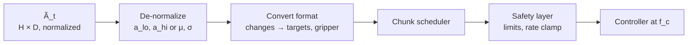
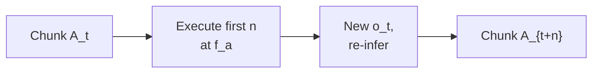
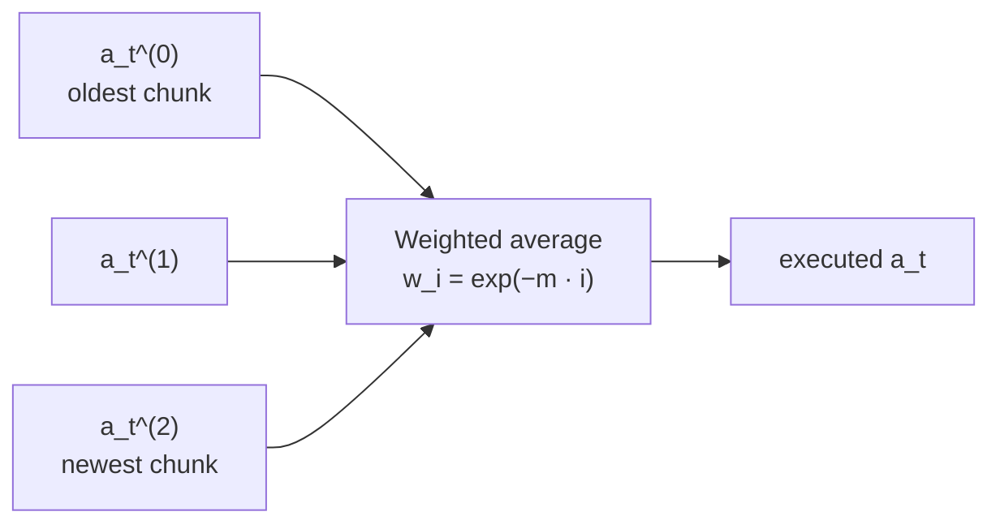
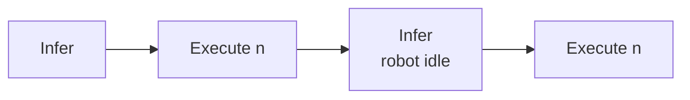
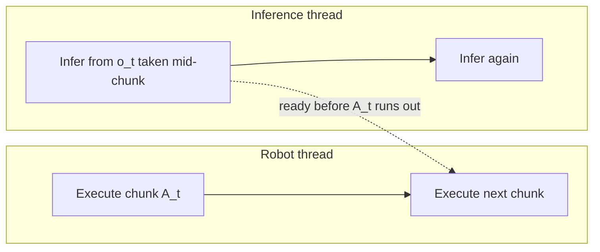

# Chapter 5 — Action Execution

After the network, the normalized chunk `Ã_t` still has to become **physical commands** delivered **at the right time**. This chapter covers de-normalization, converting to the controller's format, scheduling chunks (synchronous, receding horizon, temporal ensembling, asynchronous, real-time chunking), and the safety and controller layers below the VLA.

## Diagrams

### Post-processing pipeline



### Converting to controller format (essential)

| Model outputs | Controller expects | Conversion |
|---|---|---|
| Pose change | Absolute pose target | target = current pose + change |
| Absolute joint positions | Joint targets | Pass through, check limits |
| Euler / axis-angle rotation | Quaternion / matrix | Convert representation |
| Gripper value in `[0, 1]` | Open / close | Threshold, e.g. > 0.5 closes |

Pose changes are relative to the state **when `o_t` was captured**. If the robot moved during inference, applying them to the current pose adds error.

### Chunk scheduling strategies



| Strategy | Executed per chunk | Behavior |
|---|---|---|
| Open-loop | `n = H` | Fewest inferences, least reactive |
| Receding horizon | `n < H` | Common balance |
| Temporal ensembling | `n = 1`, with overlaps averaged | Smoothest, but one inference per action |

### Temporal ensembling (ACT)



### Synchronous vs. asynchronous

Synchronous execution: the robot waits during every inference.



Asynchronous execution: the next chunk is computed while the current one runs (for example, SmolVLA's async inference stack).



### Real-Time Chunking (RTC)

When the new chunk arrives, `s` actions have already run. Switching naively causes a jump. RTC (Physical Intelligence, 2025) **freezes** the first `s` actions of the new chunk to match what will execute, and generates the rest to be consistent with them. It does this as inpainting during flow integration.


### Safety and control (essential in practice)

Every deployment adds a safety layer outside the model: clip to joint and workspace limits, rate-limit jumps, and provide an emergency stop. A classical controller (joint PD, Cartesian impedance) then tracks the targets at `f_c`.

## Formulas

De-normalization (the inverse of Chapter 4):

```text
quantile:  a = ½ · (ã + 1) · (a_hi − a_lo) + a_lo
mean/std:  a = σ · ã + μ
```

Temporal ensembling over the overlapping predictions of `a_t` (`i = 0` is the oldest):

```text
a_t = Σ_i w_i · a_t^{(i)}  /  Σ_i w_i ,      w_i = exp(−m · i)
```

Asynchronous timing:

```text
s = ⌈T_inf · f_a⌉           actions run while the next chunk is computed
no-wait condition:  T_inf ≤ n / f_a
```

## Running example

| Quantity | Computation | Value |
|---|---|---|
| Time to execute `n` actions | 25 / 50 | 0.5 s |
| No-wait condition | 0.073 ≤ 0.5 | satisfied |
| Frozen prefix for RTC `s` | ⌈0.073 · 50⌉ | 4 actions |
| Synchronous idle fraction | 0.073 / 0.573 | 12.7 % |
| Temporal ensembling cost | 1 inference per action | 50 inferences/s, which a 73 ms model cannot sustain |

The last row is why large VLAs use receding horizon plus asynchronous execution, not per-step ensembling.

## Worked example

**De-normalize** one position dimension with `a_lo = −0.02 m`, `a_hi = 0.02 m` and model output `ã = 0.5`:

```text
a = ½ · (0.5 + 1) · (0.02 − (−0.02)) + (−0.02)
  = 0.5 · 1.5 · 0.04 − 0.02
  = 0.03 − 0.02 = 0.01 m
```

If the current position is 0.40 m, the target is 0.40 + 0.01 = **0.41 m**.

**Temporal ensembling** with three predictions of the same `a_t` (oldest first): 0.10, 0.12, 0.14, and `m = ln 2`, so the weights are 1, 0.5, 0.25:

```text
a_t = (1 · 0.10 + 0.5 · 0.12 + 0.25 · 0.14) / (1 + 0.5 + 0.25)
    = (0.10 + 0.06 + 0.035) / 1.75
    = 0.195 / 1.75 ≈ 0.1114
```

## NumPy snippet

```python
import numpy as np

def denormalize(a_n, a_lo, a_hi):
    return 0.5 * (a_n + 1) * (a_hi - a_lo) + a_lo

print(denormalize(0.5, -0.02, 0.02))         # 0.01

def ensemble(preds, m):                       # preds: oldest first
    w = np.exp(-m * np.arange(len(preds)))
    return (w * preds).sum() / w.sum()

print(ensemble(np.array([0.10, 0.12, 0.14]), np.log(2)))   # 0.11142857...
```

## Key takeaways

- De-normalize with the statistics for **your** robot. Wrong statistics move the robot plausibly but wrongly.
- Convert the model's action format (changes, rotation form, gripper) to the controller's.
- Receding horizon (`n < H`) balances smoothness and reactivity. Temporal ensembling is smoothest but needs one inference per action.
- Asynchronous execution removes idle time when `T_inf ≤ n / f_a`. RTC removes the jump at chunk boundaries by freezing the `s` actions in flight.
- A safety layer and a classical controller always sit between the VLA and the motors.

## References

1. T. Z. Zhao et al., "Learning Fine-Grained Bimanual Manipulation with Low-Cost Hardware" (ACT), *RSS*, 2023.
2. K. Black, M. Y. Galliker, S. Levine, "Real-Time Execution of Action Chunking Flow Policies," *NeurIPS*, 2025.
3. C. Chi et al., "Diffusion Policy: Visuomotor Policy Learning via Action Diffusion," *RSS*, 2023.
4. M. J. Kim et al., "OpenVLA: An Open-Source Vision-Language-Action Model," *CoRL*, 2024.
5. K. Black et al., "π0: A Vision-Language-Action Flow Model for General Robot Control," *RSS*, 2025.
6. Hugging Face Blog, "SmolVLA: Efficient Vision-Language-Action Model trained on Lerobot Community Data," Jun. 2025. https://huggingface.co/blog/smolvla
7. O. Khatib, "A Unified Approach for Motion and Force Control of Robot Manipulators: The Operational Space Formulation," *IEEE Journal on Robotics and Automation*, 3(1), 1987.
8. K. M. Lynch, F. C. Park, *Modern Robotics: Mechanics, Planning, and Control*, Cambridge University Press, 2017. (Textbook.)
9. B. Siciliano, L. Sciavicco, L. Villani, G. Oriolo, *Robotics: Modelling, Planning and Control*, Springer, 2009. (Textbook.)

---

← Previous: [Chapter 4 — Action Heads](ch-4-action-heads.md) | Next → [Chapter 6 — Dual-System Architectures](ch-6-dual-system-architectures.md)
