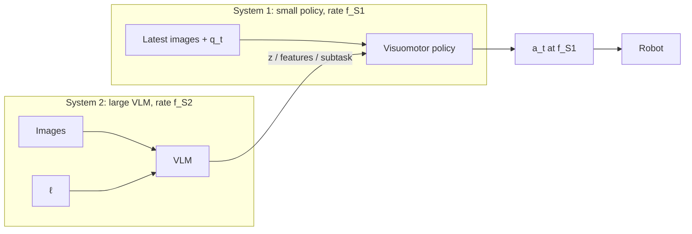
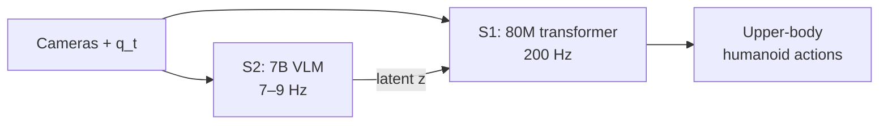
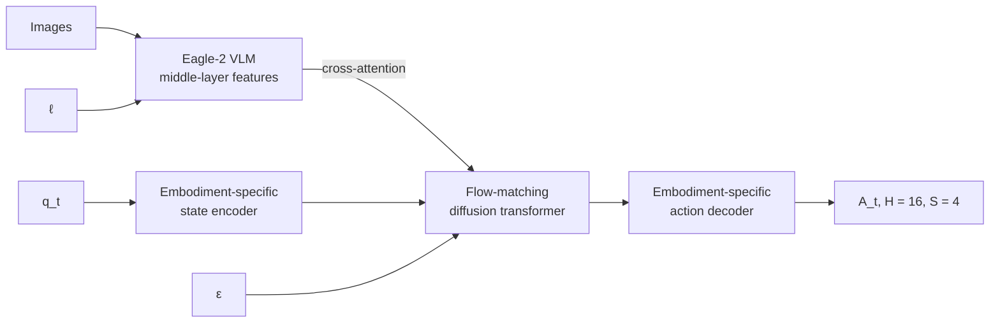
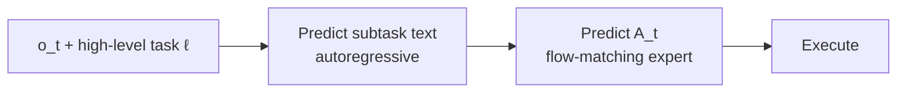

# Chapter 6 — Dual-System Architectures

A billion-parameter VLM understands scenes and instructions but is too slow for reactive control. A small policy is fast but knows little about the world. **Dual-system** VLAs use both: a slow **System 2** for understanding and a fast **System 1** for acting, running **asynchronously** at different rates. The names come from Kahneman's "fast and slow" thinking.

## Diagrams

### General pattern



- System 1 never waits for System 2. It reuses the **latest** System 2 output.
- System 1 always sees **fresh** observations, so it stays reactive even when the guidance is slightly old.

### Interface options

| Interface | System 2 sends | Example | Trade-off |
|---|---|---|---|
| Latent vector `z` | Learned embedding | Helix | Rich, not interpretable |
| Feature tokens | Hidden states that System 1 cross-attends to | GR00T N1 | Rich, tight coupling |
| Language subtask | Text such as "grasp the cup handle" | π0.5, Hi Robot | Interpretable, lossy, extra decoding time |

### Helix (Figure, 2025)



As described in Figure's announcement, both systems run on embedded GPUs on the robot.

### GR00T N1 (NVIDIA, 2025)



### π0.5: hierarchy through language



The same model first writes a short subtask, then produces actions for it. The high-level step can run less often than the low-level one.

π0 (Chapter 3) also has a "big VLM + small expert" structure, but runs both **together** in each inference. In a dual-system design they run **at different rates**.

## Formulas

```text
System 1 steps per System 2 update  = f_S1 / f_S2
Maximum age of System 2 guidance    ≈ 1 / f_S2   (plus System 2 latency)
```

## Running example

Using Helix-like rates `f_S1 = 200 Hz`, `f_S2 = 8 Hz`:

| Quantity | Computation | Value |
|---|---|---|
| S1 steps per `z` update | 200 / 8 | 25 |
| Maximum age of `z` | 1 / 8 | 0.125 s |
| Single-model `f_a` limit if a 7B model had to act alone at `T_inf` = 0.125 s with one action per call | 1 / 0.125 | 8 Hz |

The split raises the action rate from about 8 Hz to 200 Hz while keeping the 7B model's understanding.

## Worked example

`f_S1 = 10 Hz`, `f_S2 = 2 Hz`, so System 1 runs `10 / 2 = 5` steps per latent:

```text
time (s)   0.0  0.1  0.2  0.3  0.4  0.5  0.6  0.7  0.8  0.9
S2 output  z0                       z1
S1 uses    z0   z0   z0   z0   z0   z1   z1   z1   z1   z1
```

Each S1 step uses the newest `z` and a fresh observation. `z0` is used for up to 0.5 s = `1 / f_S2`.

## NumPy snippet

```python
import numpy as np

f_S1, f_S2 = 10, 2
steps = np.arange(10)
latent_index = (steps * f_S2) // f_S1      # which z each S1 step uses
print(latent_index)                        # [0 0 0 0 0 1 1 1 1 1]
```

## Key takeaways

- Dual systems split understanding (slow, large) from control (fast, small).
- The systems run asynchronously. System 1 combines fresh observations with the latest System 2 guidance.
- The interface can be a latent `z`, cross-attended features, or language subtasks. Each trades richness against interpretability.
- In the Helix-like running example, the action rate rises from about 8 Hz to 200 Hz, and guidance is at most 0.125 s old.

## References

1. L. X. Shi et al., "Hi Robot: Open-Ended Instruction Following with Hierarchical Vision-Language-Action Models," *ICML*, PMLR 267, 2025.
2. K. Black et al. (Physical Intelligence), "π0.5: a Vision-Language-Action Model with Open-World Generalization," *CoRL*, PMLR 305, 2025.
3. K. Black et al., "π0: A Vision-Language-Action Flow Model for General Robot Control," *RSS*, 2025.
4. Figure AI, "Helix: A Vision-Language-Action Model for Generalist Humanoid Control," company blog, Feb. 2025. https://figure.ai/news/helix
5. NVIDIA Technical Blog, "Accelerate Generalist Humanoid Robot Development with NVIDIA Isaac GR00T N1," Mar. 2025. https://developer.nvidia.com/blog/accelerate-generalist-humanoid-robot-development-with-nvidia-isaac-gr00t-n1
6. M. Ahn et al., "Do As I Can, Not As I Say: Grounding Language in Robotic Affordances" (SayCan), *CoRL*, 2022.
7. D. Driess et al., "PaLM-E: An Embodied Multimodal Language Model," *ICML*, 2023.
8. A. Brohan et al., "RT-2: Vision-Language-Action Models Transfer Web Knowledge to Robotic Control," *CoRL*, 2023.

---

← Previous: [Chapter 5 — Action Execution](ch-5-action-execution.md) | Next → [Chapter 7 — Inference Optimization](ch-7-inference-optimization.md)
