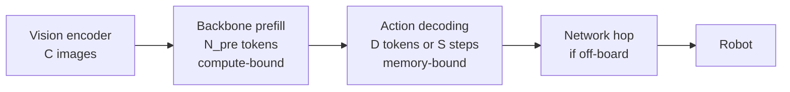
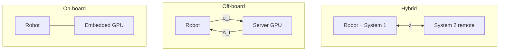

# Chapter 7 — Inference Optimization

To run on a real robot, a VLA must meet its latency budget. This chapter gives two first-principles estimates. The **prefill is compute-bound** (count FLOPs). **Decoding is memory-bound** (count bytes read). It then maps each optimization technique to the cost it reduces, and closes with the deployment topologies.

## Diagrams

### Where the time goes



### Optimization map

```mermaid
flowchart LR
    subgraph IN[Inputs]
        direction LR
        O1["Fewer image tokens<br/>lower R, merge, fewer C"]
    end
    subgraph BB[Backbone]
        direction LR
        O2["Quantize: smaller β"] ~~~ O3["Skip layers: smaller L"] ~~~ O4[Fused kernels<br/>FlashAttention]
    end
    subgraph DEC[Decoding]
        direction LR
        O5[KV cache reuse] ~~~ O6[Parallel decoding] ~~~ O7["Fewer steps S"] ~~~ O8["Chunking: larger n"]
    end
    subgraph SYS[System]
        direction LR
        O9[Async execution] ~~~ O10[Dual system] ~~~ O11[On-board vs. remote]
    end
    IN --> BB --> DEC --> SYS
```



| Technique | Reduces | Watch out for |
|---|---|---|
| Fewer image tokens | `N_pre`, so prefill FLOPs | Loss of visual detail |
| Quantization (int8 / int4) | `β`, so memory and decode time | Task success may drop. Re-validate. |
| Layer skipping (SmolVLA, GR00T N1) | `L` | Must be trained that way |
| Fused kernels (FlashAttention, TensorRT, `torch.compile`) | Memory traffic, launch overhead | Prefer static shapes |
| KV cache reuse | Repeated prefill | Needs a block-wise causal mask (Chapter 3) |
| Parallel decoding (OpenVLA-OFT) | `D` or `H · D` sequential steps → 1 | Needs fine-tuning |
| Fewer integration steps | `S` | Too few loses precision |
| Chunking | Prefills per second, `f_inf = f_a / n` | Open-loop within a chunk |
| Async / dual system | Robot idle time | Staleness (Chapters 5, 6) |

### Deployment topologies



| Topology | Pros | Cons |
|---|---|---|
| On-board | No network delay, works offline | Limited compute |
| Off-board | Large GPUs, easy updates | Network delay and jitter (π0 reports +13 ms) |
| Hybrid | Fast loop local, large model remote | Two systems to synchronize |

A client-server policy API (the robot sends `o_t`, the server returns `A_t`) keeps the robot code the same in all three cases.

## Formulas

Rules of thumb that ignore attention FLOPs and overheads:

```text
weight memory        = N_θ · β                         bytes
prefill compute      F ≈ 2 · N_θ · N_pre               FLOPs
expert step compute  F ≈ 2 · N_θ · N_suf               FLOPs
decode step time     ≥ N_θ · β / BW                    s   (all weights read once per step)
prefills per second  = f_inf = f_a / n
```

## Running example

**π0-style model** (`N_θ` = 2×10⁹ for the VLM and 3×10⁸ for the expert, `N_pre = 776`, `N_suf = 51`, `S = 10`). The GPU is assumed to sustain 10¹⁴ FLOP/s:

| Quantity | Computation | Value |
|---|---|---|
| Prefill `F` | 2 · 2×10⁹ · 776 | 3.104×10¹² FLOPs |
| Prefill time at 10¹⁴ FLOP/s | 3.104×10¹² / 10¹⁴ | ≈ 31 ms (π0 reports 32 ms) |
| One expert step `F` | 2 · 3×10⁸ · 51 | 3.06×10¹⁰ FLOPs |
| `S = 10` expert steps | 10 · 3.06×10¹⁰ | 3.06×10¹¹ FLOPs ≈ 3.1 ms |
| Prefill / all expert steps | 3.104×10¹² / 3.06×10¹¹ | ≈ 10× |
| Whole-model weights, bf16 (≈ 3.3×10⁹ parameters) | 3.3×10⁹ · 2 | 6.6 GB |

π0 reports 27 ms for its 10 expert steps, far above the 3.1 ms compute estimate. Small-batch steps are limited by memory traffic and kernel overhead, not by FLOPs.

**OpenVLA** (`N_θ` ≈ 7.5×10⁹, `D = 7` decode steps per action, `BW = 10¹²` bytes/s):

| Quantity | bf16 (`β = 2`) | int4 (`β = 0.5`) |
|---|---|---|
| Weight memory | 15 GB | 3.75 GB |
| One decode step (lower bound) | 15 ms | 3.75 ms |
| 7 decode steps | 105 ms | 26.25 ms |
| Action-rate upper bound from decoding alone | ≈ 9.5 Hz | ≈ 38 Hz |

The prefill adds more on top, which is consistent with the ≈ 6 Hz OpenVLA reports.

**Passes per second of motion** at `f_a = 50 Hz`:

| Approach | Prefills / s | Sequential steps / s |
|---|---|---|
| One action per inference, `D = 7` tokens | 50 | 350 LLM decode steps |
| Chunk `H = 50`, `n = 25`, flow `S = 10` | 2 | 20 small expert steps |

The first row is impossible for a 7B model on one GPU. This is why high-rate VLAs use chunks.

## Worked example

A 1×10⁹-parameter model in bf16 (`β = 2`) on a GPU with `BW = 10¹²` bytes/s:

- Weight memory `= 1×10⁹ · 2 = 2×10⁹` bytes = 2 GB
- One decode step `≥ 2×10⁹ / 10¹² = 0.002 s = 2 ms`
- Quantizing to int4 (`β = 0.5`) cuts this to 0.5 ms: memory-bound steps speed up in proportion to `β`.

## NumPy snippet

```python
import numpy as np

def decode_ms(N_theta, beta, BW=1e12):
    return N_theta * beta / BW * 1e3

def prefill_flops(N_theta, N_pre):
    return 2 * N_theta * N_pre

print(decode_ms(7.5e9, 2), 7 * decode_ms(7.5e9, 2))   # 15.0 105.0
print(decode_ms(7.5e9, 0.5))                           # 3.75
F = prefill_flops(2e9, 776)
print(F, F / 1e14 * 1e3)                               # 3.104e12  31.04 ms
```

## Key takeaways

- The prefill is compute-bound (`F ≈ 2 · N_θ · N_pre`). Shrink `N_pre`, `L` or `N_θ`.
- Decode steps are memory-bound (`≥ N_θ · β / BW`). Shrink `β` (quantize) or the number of sequential steps.
- KV caching and chunking cut how often the expensive prefill runs: 2 per second instead of 50 in the running example.
- First-principles estimates give a lower bound. Always measure end-to-end latency (p50 / p95), the achieved `f_a`, and task success together.

## References

1. R. Pope et al., "Efficiently Scaling Transformer Inference," *MLSys*, 2023.
2. T. Dao et al., "FlashAttention: Fast and Memory-Efficient Exact Attention with IO-Awareness," *NeurIPS*, 2022.
3. T. Dettmers et al., "LLM.int8(): 8-bit Matrix Multiplication for Transformers at Scale," *NeurIPS*, 2022.
4. E. Frantar et al., "GPTQ: Accurate Post-Training Quantization for Generative Pre-trained Transformers," *ICLR*, 2023.
5. J. Lin et al., "AWQ: Activation-aware Weight Quantization for LLM Compression and Acceleration," *MLSys*, 2024.
6. J. Ainslie et al., "GQA: Training Generalized Multi-Query Transformer Models from Multi-Head Checkpoints," *EMNLP*, 2023. (Covers multi-query attention.)
7. M. J. Kim, C. Finn, P. Liang, "Fine-Tuning Vision-Language-Action Models: Optimizing Speed and Success," *RSS*, 2025.
8. K. Black et al., "π0: A Vision-Language-Action Flow Model for General Robot Control," *RSS*, 2025.
9. Hugging Face Blog, "SmolVLA: Efficient Vision-Language-Action Model trained on Lerobot Community Data," Jun. 2025. https://huggingface.co/blog/smolvla
10. NVIDIA Technical Blog, "Accelerate Generalist Humanoid Robot Development with NVIDIA Isaac GR00T N1," Mar. 2025. https://developer.nvidia.com/blog/accelerate-generalist-humanoid-robot-development-with-nvidia-isaac-gr00t-n1

---

← Previous: [Chapter 6 — Dual-System Architectures](ch-6-dual-system-architectures.md) | Next → [Chapter 8 — End-to-End Walkthrough](ch-8-end-to-end-walkthrough.md)
