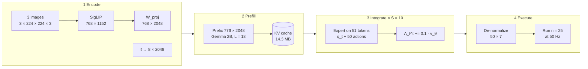
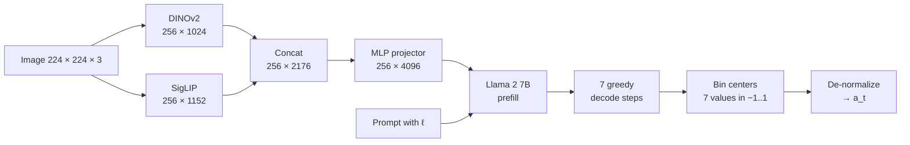

# Chapter 8 — End-to-End Walkthrough

This chapter traces **one inference step** of the running example through every component of Chapters 1–7, with tensor shapes and costs. It then traces an autoregressive OpenVLA-style step for contrast, and compares the reference models side by side.

## Diagrams

### Walkthrough A — π0-style flow-matching VLA (running example)



### Walkthrough B — OpenVLA-style autoregressive VLA



## Formulas

The whole step, written with Chapter 0 symbols:

```text
N_pre = C · (R/P)² + N_txt                                  (Ch 2)
h     = W_projᵀ h_v                                         (Ch 3)
KV    = prefill(N_pre tokens)          once per o_t         (Ch 3)
A_t^0 = ε,   A_t^{τ+δ} = A_t^τ + δ · v_θ(A_t^τ, o_t, ℓ, τ)   S times   (Ch 4)
a     = ½ · (ã + 1) · (a_hi − a_lo) + a_lo                  (Ch 5)
f_inf = f_a / n,   s = ⌈T_inf · f_a⌉                         (Ch 1, 5)
```

## Running example

| # | Step | Shape / value | Chapter |
|---|---|---|---|
| 1 | Resize and normalize `C = 3` images | 3 × 224 × 224 × 3 | 2 |
| 2 | SigLIP: `N_p = 256` per image | 768 × 1152 | 2 |
| 3 | Project with `W_proj` (2,359,296 weights) | 768 × 2048 | 3 |
| 4 | Tokenize and embed `ℓ` | 8 × 2048 | 2 |
| 5 | Prefill `N_pre = 776` tokens, store KV cache | 14,303,232 B ≈ 14.3 MB | 3 |
| 6 | Encode `q_t` with `W_q` | 1 × 1024 | 2 |
| 7 | Sample `ε` | 50 × 7 | 4 |
| 8 | `S = 10` expert passes over `N_suf = 51` tokens, `δ = 0.1` | 50 × 7 | 4 |
| 9 | De-normalize | 50 × 7, physical units | 5 |
| 10 | Execute `n = 25` at 50 Hz, re-infer asynchronously (`s = 4` actions in flight) | 0.5 s of motion | 1, 5 |

Cost summary:

| Item | Estimate (Ch 7) | Reported for π0 |
|---|---|---|
| Image encoding | — | 14 ms |
| Prefill, `F` = 3.104×10¹² FLOPs | ≈ 31 ms at 10¹⁴ FLOP/s | 32 ms |
| 10 expert passes, `F` = 3.06×10¹¹ FLOPs | ≈ 3.1 ms compute-only | 27 ms |
| Total `T_inf` | — | 73 ms |
| Inferences per second needed, `f_a / n` | 50 / 25 | 2 Hz |

For OpenVLA (walkthrough B), the 7 decode steps alone take at least 7 · 15 ms = 105 ms in bf16 at `BW = 10¹²` bytes/s, for **one** action.

## Worked example

A complete 1-D pass of the tail of the pipeline, reusing earlier numbers:

1. **Integrate** (Ch 4): `ε = −0.4`, target `Ã_t = 0.6`, `S = 2` → −0.4 → 0.1 → **0.6** (normalized).
2. **De-normalize** (Ch 5): `a_lo = −0.02 m`, `a_hi = 0.02 m`:
   `a = ½ · (0.6 + 1) · 0.04 − 0.02 = 0.5 · 1.6 · 0.04 − 0.02 = 0.032 − 0.02 = 0.012 m`.
3. **Convert** (Ch 5): current position 0.40 m → target **0.412 m**.
4. **Schedule** (Ch 1): with `f_a = 50 Hz`, this action is sent 0.02 s after the previous one.

## NumPy snippet

```python
import numpy as np

C, R, P, N_txt, H, D, S = 3, 224, 14, 8, 50, 7, 10
N_pre = C * (R // P) ** 2 + N_txt
print(N_pre)                                    # 776

eps, target = -0.4, 0.6
A, delta = eps, 1 / 2
for i in range(2):
    A = A + delta * (target - eps)              # exact velocity
a = 0.5 * (A + 1) * (0.02 - (-0.02)) + (-0.02)
print(A, round(a, 3), round(0.40 + a, 3))       # 0.6 0.012 0.412
```

## Model comparison

| Model | Vision | Backbone | State input | Action head | Chunk `H` | Sequential passes per inference |
|---|---|---|---|---|---|---|
| RT-2 | ViT (PaLI-X / PaLM-E) | Up to 55B | No | Bins, 256 | 1 | `D` LLM steps |
| Octo | Small CNN + patches | Transformer, ≤ 93M | Optional | Diffusion | Yes | Diffusion steps on a small head |
| OpenVLA | DINOv2 + SigLIP | Llama 2 7B | No | Bins, 256 | 1 | `D = 7` LLM steps |
| OpenVLA-OFT | DINOv2 + SigLIP | Llama 2 7B | Optional | Parallel L1 regression | Yes | 1 |
| π0 | SigLIP | Gemma 2B + 3×10⁸ expert | Yes | Flow matching | 50 | 1 prefill + `S = 10` expert |
| π0-FAST | SigLIP | Gemma 2B | Yes | FAST tokens | Yes | Autoregressive over compressed tokens |
| GR00T N1 | Eagle-2 | 2.2B total, middle-layer features | Yes | Flow-matching DiT | 16 | 1 VLM + `S = 4` |
| Helix | VLM (S2) | 7B S2 + 80M S1 | Yes (S1) | Continuous, `f_S1` = 200 Hz | — | S2 asynchronous at 7–9 Hz |
| SmolVLA | SigLIP (SmolVLM2) | ≈ 450M total, layer skipping | Yes | Flow matching | Yes | 1 prefill + few expert steps, async |

"—" means not stated in the public description.

## Design checklist

Use these questions to place a new VLA paper on the map:

1. **Inputs** (Ch 2): Which vision encoder? What are `C`, `R`, `P`, `N_img`? Is `q_t` used?
2. **Backbone** (Ch 3): Which VLM? All `L` layers? Which projector?
3. **Mask and cache** (Ch 3): Can the prefix be computed once?
4. **Action head** (Ch 4): Bins, FAST, regression or flow? How many sequential passes?
5. **Chunking** (Ch 4, 5): What are `H` and `n`?
6. **Execution** (Ch 5): Synchronous or asynchronous? Ensembling or RTC?
7. **System** (Ch 6): One model, or System 1 + System 2? What interface?
8. **Deployment** (Ch 7): On-board or remote? What `β`? Measured `T_inf` and `f_a`?

## Key takeaways

- In the running example, vision + prefill (≈ 46 ms reported) run once per observation. A small expert refines a 50-action chunk in 10 passes (27 ms reported).
- An OpenVLA-style model pays a 7B decode step for every action dimension: simple but slow.
- Chunking, KV caching and asynchronous execution together give a 2 Hz model a 50 Hz action stream.
- Most differences between VLAs are answers to the eight checklist questions.

## References

1. K. Black et al., "π0: A Vision-Language-Action Flow Model for General Robot Control," *RSS*, 2025.
2. M. J. Kim et al., "OpenVLA: An Open-Source Vision-Language-Action Model," *CoRL*, 2024.
3. A. Brohan et al., "RT-2: Vision-Language-Action Models Transfer Web Knowledge to Robotic Control," *CoRL*, 2023.
4. Octo Model Team, "Octo: An Open-Source Generalist Robot Policy," *RSS*, 2024.
5. K. Pertsch et al., "FAST: Efficient Action Tokenization for Vision-Language-Action Models," *RSS*, 2025.
6. M. J. Kim, C. Finn, P. Liang, "Fine-Tuning Vision-Language-Action Models: Optimizing Speed and Success," *RSS*, 2025.
7. K. Black et al. (Physical Intelligence), "π0.5: a Vision-Language-Action Model with Open-World Generalization," *CoRL*, PMLR 305, 2025.
8. NVIDIA Technical Blog, "Accelerate Generalist Humanoid Robot Development with NVIDIA Isaac GR00T N1," Mar. 2025. https://developer.nvidia.com/blog/accelerate-generalist-humanoid-robot-development-with-nvidia-isaac-gr00t-n1
9. Figure AI, "Helix: A Vision-Language-Action Model for Generalist Humanoid Control," company blog, Feb. 2025. https://figure.ai/news/helix
10. Hugging Face Blog, "SmolVLA: Efficient Vision-Language-Action Model trained on Lerobot Community Data," Jun. 2025. https://huggingface.co/blog/smolvla

---

← Previous: [Chapter 7 — Inference Optimization](ch-7-inference-optimization.md) | Next → [Chapter 0 — Overview](ch-0-overview.md)
